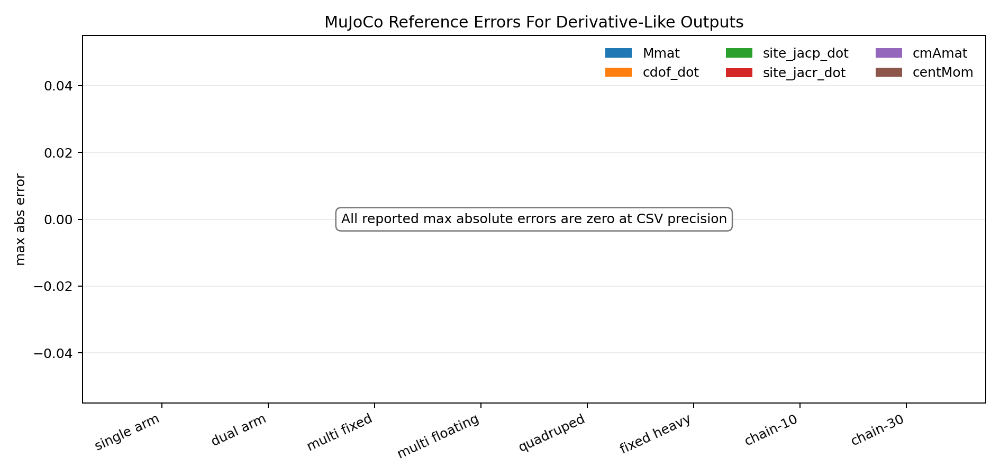

# dtDynamics Benchmark Results

Date: 2026-07-16

Updated: 2026-07-16 for the rc3 benchmark/resource schema, refreshed validation figures, and the latest package and headless LeoQuad gates.

This note records the current native `dtDynamics` benchmark baseline and the reference-path timing pass. The reference benchmarks use the private validation cache in the standalone package checkout:

- Package root: this standalone `dtDynamics` checkout
- MuJoCo 3.8.0: `.validation_deps/mujoco-3.8.0`
- Pinocchio 3.9.0: `.validation_deps/pinocchio-3.9.0`

The timing and error scopes are intentionally explicit. Native `dtDynamics` now exposes explicit dynamics entry points: `ComputeDynamicsRNEA` for MuJoCo-step1-like base ingredients and `ComputeDynamicsCCRBA` for the base ingredients plus `Cmat` and optional centroidal outputs. There is no public `ComputeDynamics` alias. RNEA accepts `dtDynRneaTermFlags`; CCRBA accepts `dtDynCcrbaTermFlags` for heavier optional centroidal outputs. Jacobian timing is reported separately in `benchmark_dtDynamicsStages`. MuJoCo and Pinocchio rows time their external reference calls for overlapping ingredients only; they are useful reference-path baselines, not a strict apples-to-apples algorithm comparison yet. The reference benchmark also emits a second CSV table with `comparison_reference,fixture,state,quantity,count,max_error,rms_error,status,diagnostic`.

The derivative-style benchmark figures are scoped to quantities already implemented by native `dtDynamics`: `MmatDot`, `Cmat`, `Jdot`, `Jdot*qvel`, `cmAmatDot`, `comJmatDot`, and related spatial derivatives. This follows the runtime/error-reporting style of analytical dynamics-derivative work such as [arXiv:2302.06001](https://arxiv.org/pdf/2302.06001) and the benchmark categories exposed by [ROAM-Lab-ND/spatial_v2_extended](https://github.com/ROAM-Lab-ND/spatial_v2_extended), but it does not claim second-order dynamics derivative support yet.

## Command

```bash
# Run from the standalone dtDynamics package root.
tools/audit_release_readiness.sh

cmake --preset validation
cmake --build --preset validation -- -j2
ctest --preset validation
build/validation/bin/benchmark_dtDynamics > /tmp/native.csv
build/validation/bin/benchmark_dtDynamicsStages > /tmp/stages.csv
build/validation/bin/benchmark_dtDynamicsReferences > /tmp/references.csv
python3 tools/plot_benchmark_results.py \
  --native /tmp/native.csv \
  --stages /tmp/stages.csv \
  --references /tmp/references.csv \
  --out docs/figures

DTDYNAMICS_BENCHMARK_ONLY_EXTERNAL=1 \
DTDYNAMICS_BENCHMARK_XML=/path/to/LeoQuad_QD1.xml \
DTDYNAMICS_BENCHMARK_XML_NAME=leoquad_qd1 \
  build/validation/bin/benchmark_dtDynamicsStages
```

Validation status for this run: `tools/audit_release_readiness.sh` passed, including `test_dtDynTypes`, `test_dtDynamicsMujocoRef`, `test_dtDynamicsPinocchioRef`, install/export validation, and release-invariant scans.

Important: benchmark numbers must come from a Release build. A default single-config CMake build leaves `CMAKE_BUILD_TYPE` empty, compiling native `dtDynamics` with no `-O` flag while MuJoCo and Pinocchio are optimized prebuilt libraries. That unoptimized configuration made native `dtDynamics` look roughly an order of magnitude slower than it is.

The Pinocchio/Boost CMake warnings observed during validation configure are not production package warnings. They come from the private Pinocchio validation prefix and CMake's Boost discovery policy/runtime-path diagnostics. `benchmark_dtDynamicsReferences` builds and runs to completion, emits both timing and error-summary CSV sections, and resolves MuJoCo/Pinocchio libraries from the standalone package's `.validation_deps` cache. These warnings should not block benchmark use unless the reference executable fails to start or reports nonzero reference errors.

All benchmark executables append a final `benchmark_metadata,key,value` CSV section. It records the executable name, build type, compiler, C++ standard, platform, CPU model, hardware concurrency, clock source, clock steadiness, warmup iterations, measured iterations, batch count, and `NDEBUG` status. This metadata is appended after timing/error rows so existing timing parsers can continue to consume the primary CSV sections by header.

Set `DTDYNAMICS_BENCHMARK_BATCHES=N` for repeated-run aggregation. When `N > 1`, the benchmarks append `benchmark_batch_summary` rows containing min/median/max of per-batch mean, median, and p99 runtime plus the maximum allocation count across batches. The default is one batch, which preserves the compact timing output.

Each row uses 20 warmup iterations and 200 measured iterations. Allocation counts are measured by intercepting global C++ `operator new` / `operator new[]` while the measured call is active; they do not intercept dtMath or library allocations that route directly through `malloc`/`calloc`/`realloc`.

The raw benchmark CSVs retain allocation counters for regression checking. Human-readable timing tables omit allocation columns when every displayed row in that scope is zero; zero allocation is stated once in prose instead of repeated in every row.

## Part A — Native dynamics-only scope

The native benchmark is intentionally dynamics-only and emits two labeled rows for every fixture/state:

- `native_ccrba_all`: `ComputeDynamicsCCRBA(model, data, gravity, DTDYN_CCRBA_TERM_ALL)` computes the base CCRBA outputs and every optional CCRBA term.
- `native_rnea_com_pos`: `ComputeDynamicsRNEA(model, data, gravity, DTDYN_RNEA_TERM_COM_POS)` computes the RNEA base outputs plus root CoM position.

The native CSV schema includes a `scope` column so plots and tables cannot silently mix the two algorithms. Cross-engine figures select `native_ccrba_all`; the raw CSV retains all 48 native rows (eight fixtures, three states, and two scopes). RNEA rows report centroidal-matrix product consistency fields as `nan` because RNEA does not produce `cmAmat`, `centMom`, `comJmat`, or `comVel`.

### Nominal native timing

| Fixture | nq | nv | bodies | CCRBA all median / p99 us | RNEA + CoM median / p99 us |
|---|---:|---:|---:|---:|---:|
| single_manipulator_fixed_base | 3 | 3 | 5 | 1.218 / 1.292 | 1.519 / 1.601 |
| dual_manipulator_fixed_base | 4 | 4 | 6 | 1.509 / 1.599 | 1.892 / 2.009 |
| multi_robot_fixed_base | 4 | 4 | 8 | 1.739 / 1.816 | 2.268 / 2.375 |
| multi_robot_floating_base | 18 | 16 | 8 | 3.854 / 4.060 | 3.094 / 3.283 |
| quadruped_floating_base | 19 | 18 | 14 | 6.412 / 10.446 | 5.758 / 8.339 |
| fixed_body_heavy | 1 | 1 | 11 | 1.609 / 1.660 | 2.838 / 2.936 |
| serial_chain_10 | 10 | 10 | 12 | 4.186 / 4.383 | 4.445 / 4.719 |
| serial_chain_30 | 30 | 30 | 32 | 18.059 / 33.745 | 13.879 / 27.088 |

### Floating-base quadruped states

| State | CCRBA all median / p99 us | RNEA + CoM median / p99 us |
|---|---:|---:|
| nominal | 6.412 / 10.446 | 5.758 / 8.339 |
| asymmetric | 6.459 / 6.689 | 5.903 / 6.268 |
| nonzero_velocity | 8.328 / 13.540 | 6.052 / 6.325 |

For both native scopes, mass-matrix symmetry and `nonlinTorq = coriolisTorq + gravityTorq` consistency errors were zero at benchmark output precision. CCRBA-all rows additionally reported zero `centMom = cmAmat * qvel` and `comVel = comJmat * qvel` consistency errors.

### Figures

The figures are generated from the same CSV outputs as the tables:





### Native stage breakdown

`benchmark_dtDynamicsStages` splits the native pipeline into public API stages and internal CCRBA/RNEA substages. Each stage starts from the prerequisite state needed by that API, so the rows are diagnostic timings rather than additive exclusive profiler samples.

The setup-only `benchmark_dtDynamics` resource rows (`dtDynModel_resource` and `dtDynData_resource`) inspect model compilation and data resize cost outside the realtime loop. These rows are included here to make setup cost explicit; they are not part of the controller update timing. The human-facing table omits allocation columns because compute allocation columns are all zero and setup allocation counts are diagnostic counter values rather than time. The CSV still keeps allocation counters for regression checks.

| Fixture | nq | nv | bodies | Compile median us | Compile p99 us | Data resize median us | Data resize p99 us |
|---|---:|---:|---:|---:|---:|---:|---:|
| single_manipulator_fixed_base | 3 | 3 | 5 | 1.807 | 3.075 | 1.928 | 2.926 |
| dual_manipulator_fixed_base | 4 | 4 | 6 | 2.200 | 2.483 | 2.262 | 4.032 |
| multi_robot_fixed_base | 4 | 4 | 8 | 2.789 | 4.052 | 2.481 | 4.384 |
| multi_robot_floating_base | 18 | 16 | 8 | 3.281 | 4.318 | 3.698 | 5.712 |
| quadruped_floating_base | 19 | 18 | 14 | 6.876 | 9.363 | 5.415 | 7.675 |
| fixed_body_heavy | 1 | 1 | 11 | 2.617 | 3.803 | 2.688 | 4.340 |
| serial_chain_10 | 10 | 10 | 12 | 3.617 | 6.417 | 3.814 | 5.788 |
| serial_chain_30 | 30 | 30 | 32 | 12.706 | 18.478 | 10.217 | 16.491 |

For the floating-base quadruped fixture, the median stage times in microseconds were:

| State | FK | Mass after FK | CCRBA after FK | CCRBA prereq | CCRBA extended | Body Jacobians | Site Jacobians | All Jacobians | Indexed Jacobians | Gravity | RNEA + CoM | CCRBA all |
|---|---:|---:|---:|---:|---:|---:|---:|---:|---:|---:|---:|---:|
| nominal | 2.001 | 1.575 | 4.653 | 1.122 | 3.343 | 2.548 | 0.810 | 3.462 | 0.990 | 0.062 | 5.711 | 6.344 |
| asymmetric | 2.105 | 1.585 | 4.589 | 1.095 | 3.269 | 2.463 | 0.787 | 3.455 | 0.983 | 0.062 | 5.719 | 6.333 |
| nonzero_velocity | 2.108 | 1.693 | 6.489 | 2.734 | 3.311 | 2.511 | 0.788 | 3.542 | 1.000 | 0.062 | 5.977 | 8.241 |

A focused run for the multi-root fixtures validates the timing path for independent model parts plus fixed sensor frames. Median stage times in microseconds were:

| Fixture | State | FK | Mass after FK | CCRBA after FK | CCRBA prereq | CCRBA extended | Indexed Jacobians | RNEA + CoM | CCRBA all | Reduced WBC update |
|---|---|---:|---:|---:|---:|---:|---:|---:|---:|---:|
| multi_robot_fixed_base | nominal | 0.844 | 0.566 | 0.909 | 0.508 | 0.358 | 0.123 | 2.249 | 1.705 | 1.652 |
| multi_robot_fixed_base | asymmetric | 0.878 | 0.556 | 0.917 | 0.516 | 0.356 | 0.130 | 2.342 | 1.757 | 1.717 |
| multi_robot_fixed_base | nonzero_velocity | 0.889 | 0.575 | 1.432 | 0.995 | 0.355 | 0.130 | 2.397 | 2.265 | 2.237 |
| multi_robot_floating_base | nominal | 0.906 | 1.133 | 3.545 | 0.703 | 2.714 | 0.725 | 3.092 | 4.065 | 3.817 |
| multi_robot_floating_base | asymmetric | 0.947 | 1.066 | 3.532 | 0.716 | 2.724 | 0.727 | 3.050 | 4.034 | 3.817 |
| multi_robot_floating_base | nonzero_velocity | 0.941 | 1.067 | 4.660 | 1.666 | 2.640 | 0.725 | 3.119 | 5.095 | 4.875 |

## Part B — LeoQuad reduced-mask scope

The LeoQuad controller scope is deliberately smaller than the native all-feature scope:

```cpp
constexpr dtDynCcrbaTermFlags leoquadMask =
    DTDYN_CCRBA_TERM_COM_POS |
    DTDYN_CCRBA_TERM_CMAMAT |
    DTDYN_CCRBA_TERM_CENT_MOM;

ComputeDynamicsCCRBA(model, data, gravity, leoquadMask);
ComputeJacobians(model, data, bodyIds, siteIds);
```

`bodyIds` contains the root/base body and `siteIds` contains the four foot sites. The dynamics-only reduced call is labeled `leoquad_reduced_ccrba`; the combined controller-shaped call is `leoquad_wbc_update`. The following fresh 200-iteration medians use the canonical current `leoquad-control/model/LeoQuad_QD1.xml` fixture and are evidence snapshots rather than platform-independent guarantees:

| State | CCRBA all median us | RNEA + CoM median us | Reduced CCRBA median us | Reduced CCRBA + indexed Jacobians median us |
|---|---:|---:|---:|---:|
| nominal | 6.392 | 5.942 | 5.128 | 7.673 |
| asymmetric | 6.646 | 5.943 | 5.373 | 9.096 |
| nonzero_velocity | 8.053 | 6.016 | 6.884 | 9.416 |

The external fixture remains opt-in through `DTDYNAMICS_BENCHMARK_XML`; `DTDYNAMICS_BENCHMARK_ONLY_EXTERNAL=1` restricts the run to that XML and `DTDYNAMICS_BENCHMARK_XML_NAME` controls the CSV fixture label. The standalone package therefore does not depend on LeoQuad assets.

After replacing temporary 6x6 cross-matrix construction in the CCRBA bias-force assembly with direct sparse cross-term accumulation, removing the redundant local `Bmat` scratch array, computing local bias directly into `BmatComp`, fusing the public CCRBA `Cmat*qvel` product into the `Cmat` fill loop, skipping zero-velocity local bias construction, skipping zero bias-force products, avoiding redundant nonzero-body inertia clears, grouping local motion-cross updates by spatial-inertia column, combining paired DOF 6x6-vector products, filling body spatial inertia directly in place, replacing scaled spatial temporaries with in-place scaled adds, caching compiled body/inertial/site rotation matrices, using a data-internal combined indexed `J`/`Jdot` writer for controller-selected body/site Jacobians, moving diff-motion zeroing to exact write sites with exact-zero cross-product skips, writing `cdof` and nonzero `cdof_dot` directly, keeping the local momentum multiply inside `ComputeBiasMatrix` in dtMath operator form after benchmark-confirming no meaningful regression, carrying a per-body `BmatCompNonzero` flag through composite bias accumulation, skipping redundant `BmatComp` clears when the flag prevents reads, writing zero-derivative DOF bias products directly into `f2` with `SpatialMulInto`, and unrolling fixed-size 6x6 spatial matrix-vector products in the DOF bias-force path, the following historical optimization batch-summary medians were recorded before the fresh scope run above:

| State | CCRBA prereq | Local bias matrices | Bias accumulation | DOF bias forces | CCRBA bias forces | WBC CCRBA Terms | LeoQuad WBC Update |
| --- | ---: | ---: | ---: | ---: | ---: | ---: | ---: |
| nominal | 0.940 | 0.063 | 0.027 | 0.194 | 0.251 | 4.235 | 6.210 |
| asymmetric | 0.991 | 0.064 | 0.027 | 0.194 | 0.251 | 4.404 | 6.503 |
| nonzero_velocity | 2.248 | 0.798 | 0.114 | 0.546 | 1.531 | 5.831 | 7.830 |

The current optimization pass stops at this point to preserve readability. The remaining nonzero local-bias matrix row is the next possible target, but reducing it further would likely require replacing the readable `ComputeBiasMatrix` assembly helpers with a larger hand-expanded formula.

A profiled headless LeoQuad trot validation run with `SIMROBOT_PROFILE_DYNAMICS=1` reported `Robot::UpdateDynamics` timing over the actual control path. After removing redundant exact-size zeroing in controller-facing copy helpers, the current validation run is:

| samples | mean us | min us | max us | last us |
|---:|---:|---:|---:|---:|
| 20103 | 15.589 | 11.131 | 163.781 | 12.415 |

The same run emitted the opt-in split timing:

| input mean us | native mean us | export mean us | input last us | native last us | export last us |
|---:|---:|---:|---:|---:|---:|
| 0.132 | 12.663 | 2.794 | 0.141 | 10.190 | 2.084 |

The native block was further split as:

| CCRBA mean us | Jacobian mean us | CCRBA last us | Jacobian last us |
|---:|---:|---:|---:|
| 10.232 | 2.432 | 8.219 | 1.971 |

`input` covers qpos/qvel staging, local `qVel` copy, and gravity setup. `native` covers the reduced `ComputeDynamicsCCRBA` call plus indexed body/site `ComputeJacobians`. `export` covers LeoQuad-side copying of computed `dtDynData` fields into existing controller-facing members and derived base/task quantities. The split still shows the main remaining runtime cost is reduced CCRBA under the real LeoQuad model/state, but the direct bias-force assembly, local-scratch cleanup, compiled rotation caches, combined indexed Jacobian writer, diff-motion zero fast path, composite bias nonzero flag, and no-temporary DOF bias product keep the latest isolated-prefix headless CCRBA mean near 10.2 us with no measured allocation in the native benchmark rows.

The CCRBA extended stage is further split as:

| State | Dense clear | Root CoM | CMM/CMMdot | Mmat | MmatDot | Cmat | CoM J/Jdot | CMM*qvel | CoM J*qvel | Cmat*qvel | Combined products |
|---|---:|---:|---:|---:|---:|---:|---:|---:|---:|---:|---:|
| nominal | 0.105 | 0.023 | 0.148 | 0.347 | 0.598 | 0.717 | 0.170 | 0.207 | 0.131 | 0.533 | 0.817 |
| asymmetric | 0.115 | 0.024 | 0.150 | 0.344 | 0.618 | 0.689 | 0.169 | 0.203 | 0.126 | 0.501 | 0.775 |
| nonzero_velocity | 0.105 | 0.023 | 0.146 | 0.346 | 0.597 | 0.689 | 0.169 | 0.202 | 0.126 | 0.500 | 0.776 |

`Combined products` is one timed stage that executes the three matrix-vector products sequentially: `centMom = cmAmat * qvel`, `comVel = comJmat * qvel`, and the standalone diagnostic `coriolisTorq = Cmat * qvel`. It is not a fourth mathematical output, and its measured median need not equal the arithmetic sum of the three separately timed medians because each row has independent timer/cache effects.

The `Cmat*qvel` row remains in the stage benchmark as a diagnostic standalone product. The public `ComputeDynamicsCCRBA` path no longer pays that separate dense pass: it accumulates `coriolisTorq` while filling `Cmat`, then forms `nonlinTorq = gravityTorq + coriolisTorq`.

The old top-level spatial-array pre-clear was removed after confirming downstream stages overwrite the spatial work arrays (`cdof`, `cdof_dot`, `cvel`, `cinert`, `crb`, `BmatComp`, and `f1/f2/f3`). Dense output matrix clearing remains inside the CCRBA path because non-ancestor entries in `Mmat`, `MmatDot`, and `Cmat` are intentionally not written by the parent-chain loops and must remain zero.

Fresh CCRBA-all nominal medians were 1.218 us for the single manipulator, 1.509 us for the dual manipulator, 1.739 us for multi-robot fixed base, 3.854 us for multi-robot floating base, and 1.609 us for the fixed-body-heavy fixture. All measured stage compute rows reported zero counted C++ `operator new` allocation; the raw stage CSV retains allocation counters for regression checks.

This explains most of the remaining native-vs-MuJoCo timing difference. `DTDYN_CCRBA_TERM_ALL` computes controller-specific quantities beyond the MuJoCo overlap set. LeoQuad does not need all of those terms each control tick, so its runtime call requests only `COM_POS`, `CMAMAT`, and `CENT_MOM`; the stage benchmark includes this as `leoquad_reduced_ccrba`. The stage benchmark also includes `leoquad_wbc_update`, which runs the reduced CCRBA call followed by indexed body/site `ComputeJacobians` to match the LeoQuad runtime order. The native `compute_dynamics_rnea_com_pos` stage uses `DTDYN_RNEA_TERM_COM_POS` and is closer to MuJoCo's bias-force path and avoids the CCRBA matrices. CCRBA computes gravity, Coriolis, and nonlinear torque ingredients from the centroidal/`Cmat` pass instead of calling RNEA. In the extended substage, dense output clearing is small; `Cmat` and `MmatDot` are the main per-term matrix costs, and the standalone `Cmat*qvel` row is now a diagnostic cost avoided by the public CCRBA entry point. In the prerequisite substage, zero-velocity states are now much cheaper because the local bias matrix and zero bias products are skipped exactly, `BmatCompNonzero` avoids scanning/accumulating known-zero composite bias matrices, and zero-derivative DOF bias products write directly into `f2` without a returned temporary. Nonzero velocity states still pay the real local-bias cost, but grouped local motion-cross updates reduce that row from roughly 1.5 us to roughly 0.8 us on the current real XML fixture. A readability pass restored the local momentum calculation to the dtMath `inertia * velocity` operator form after benchmarking showed no meaningful regression. Direct in-place spatial inertia filling reduces the composite inertia row to about 0.5 us, and in-place scaled adds plus direct `cdof`/`cdof_dot` spatial writes remove small temporaries from the prerequisite path. Fixed-size spatial matrix-vector kernels in the DOF bias-force path are unrolled because those products are always 6x6. Jacobian computation is separated from dynamics computation. The indexed Jacobian overload computes the requested root/base body Jacobian plus task-site Jacobians only; for the quadruped fixture this reduces Jacobian median time from about 3.7 us to about 1.05-1.07 us without counted C++ `operator new` allocation; the raw CSV retains the zero allocation counters. Public `ComputePointJacobianTerms`, `ComputeBodyJacobianTerms`, and `ComputeSiteJacobianTerms` wrappers cover one-off task requests that need `J`, `Jdot`, and `Jdot*qvel` together. Site-only Jacobian timing is useful as a diagnostic lower bound, but it is not the LeoQuad runtime contract while the base body Jacobian remains a controller input.

## Reference and validation scope

MuJoCo scope: `mj_forward`, `mj_subtreeVel`, `mj_fullM`, site Jacobians, site `Jdot`, subtree CoM Jacobian, and angular momentum matrix.

Pinocchio scope: `crba`, generalized gravity, nonlinear effects, Coriolis matrix, `ccrba`, centroidal map time variation, and centroidal momentum time variation.

| Engine | Fixture | State | nq | nv | bodies | mean us | median us | p99 us |
| --- | --- | ---: | ---: | ---: | ---: | ---: | ---: | ---: |
| mujoco | single_manipulator_fixed_base | nominal | 3 | 3 | 5 | 1.311790 | 1.309000 | 1.370000 |
| mujoco | single_manipulator_fixed_base | asymmetric | 3 | 3 | 5 | 1.421240 | 1.419000 | 1.486000 |
| mujoco | single_manipulator_fixed_base | nonzero_velocity | 3 | 3 | 5 | 1.417905 | 1.415000 | 1.498000 |
| mujoco | dual_manipulator_fixed_base | nominal | 4 | 4 | 6 | 1.676770 | 1.583000 | 2.766000 |
| mujoco | dual_manipulator_fixed_base | asymmetric | 4 | 4 | 6 | 1.733755 | 1.668000 | 3.002000 |
| mujoco | dual_manipulator_fixed_base | nonzero_velocity | 4 | 4 | 6 | 1.724555 | 1.668000 | 2.177000 |
| mujoco | multi_robot_fixed_base | nominal | 4 | 4 | 8 | 2.082535 | 2.035000 | 2.569000 |
| mujoco | multi_robot_fixed_base | asymmetric | 4 | 4 | 8 | 2.182065 | 2.179000 | 2.264000 |
| mujoco | multi_robot_fixed_base | nonzero_velocity | 4 | 4 | 8 | 2.178980 | 2.146000 | 2.374000 |
| mujoco | multi_robot_floating_base | nominal | 18 | 16 | 8 | 3.527945 | 3.433000 | 5.424000 |
| mujoco | multi_robot_floating_base | asymmetric | 18 | 16 | 8 | 3.671085 | 3.669000 | 3.769000 |
| mujoco | multi_robot_floating_base | nonzero_velocity | 18 | 16 | 8 | 3.773460 | 3.730000 | 4.089000 |
| mujoco | quadruped_floating_base | nominal | 19 | 18 | 14 | 5.660370 | 5.442000 | 7.967000 |
| mujoco | quadruped_floating_base | asymmetric | 19 | 18 | 14 | 6.102995 | 6.060000 | 6.381000 |
| mujoco | quadruped_floating_base | nonzero_velocity | 19 | 18 | 14 | 6.195770 | 6.101000 | 9.170000 |
| mujoco | fixed_body_heavy | nominal | 1 | 1 | 11 | 1.922715 | 1.921000 | 2.003000 |
| mujoco | fixed_body_heavy | asymmetric | 1 | 1 | 11 | 2.003010 | 1.958000 | 2.311000 |
| mujoco | fixed_body_heavy | nonzero_velocity | 1 | 1 | 11 | 1.991585 | 1.962000 | 3.391000 |
| pinocchio | single_manipulator_fixed_base | nominal | 3 | 3 | 5 | 3.219100 | 3.130000 | 4.212000 |
| pinocchio | single_manipulator_fixed_base | asymmetric | 3 | 3 | 5 | 3.356900 | 3.213000 | 4.364000 |
| pinocchio | single_manipulator_fixed_base | nonzero_velocity | 3 | 3 | 5 | 3.321410 | 3.222000 | 4.176000 |
| pinocchio | dual_manipulator_fixed_base | nominal | 4 | 4 | 6 | 4.207190 | 4.022000 | 5.095000 |
| pinocchio | dual_manipulator_fixed_base | asymmetric | 4 | 4 | 6 | 4.169210 | 4.117000 | 5.400000 |
| pinocchio | dual_manipulator_fixed_base | nonzero_velocity | 4 | 4 | 6 | 4.186035 | 4.120000 | 5.305000 |
| pinocchio | multi_robot_fixed_base | nominal | 4 | 4 | 8 | 4.088515 | 4.002000 | 5.257000 |
| pinocchio | multi_robot_fixed_base | asymmetric | 4 | 4 | 8 | 4.348015 | 4.210000 | 8.888000 |
| pinocchio | multi_robot_fixed_base | nonzero_velocity | 4 | 4 | 8 | 4.246310 | 4.123000 | 5.609000 |
| pinocchio | multi_robot_floating_base | nominal | 18 | 16 | 8 | 7.783510 | 7.597000 | 13.166000 |
| pinocchio | multi_robot_floating_base | asymmetric | 18 | 16 | 8 | 8.342935 | 7.725000 | 15.300000 |
| pinocchio | multi_robot_floating_base | nonzero_velocity | 18 | 16 | 8 | 7.804655 | 7.736000 | 13.424000 |
| pinocchio | quadruped_floating_base | nominal | 19 | 18 | 14 | 14.882575 | 14.768000 | 22.538000 |
| pinocchio | quadruped_floating_base | asymmetric | 19 | 18 | 14 | 15.159605 | 15.086000 | 20.512000 |
| pinocchio | quadruped_floating_base | nonzero_velocity | 19 | 18 | 14 | 15.214840 | 15.138000 | 20.843000 |
| pinocchio | fixed_body_heavy | nominal | 1 | 1 | 11 | 1.035020 | 1.032000 | 1.086000 |
| pinocchio | fixed_body_heavy | asymmetric | 1 | 1 | 11 | 1.061915 | 1.056000 | 1.126000 |
| pinocchio | fixed_body_heavy | nonzero_velocity | 1 | 1 | 11 | 1.067065 | 1.054000 | 1.185000 |

## Reference Error Summary

`benchmark_dtDynamicsReferences` now emits numerical error rows after the timing table. Rows with `status=ok` are numerical comparisons. Rows with `status=skipped` are explicit diagnostics for intentionally non-comparable quantities.

MuJoCo comparisons cover:

- `Mmat`
- `gravityTorq`, `coriolisTorq`, `nonlinTorq`
- `cdof`, `cdof_dot`, `cvel`
- site `jacp`, `jacr`, `jacp_dot`, `jacr_dot`
- `subtree_com`, `comJmat`, `cmAmat`, `centMom`

All MuJoCo max/RMS errors were `0.000000` at benchmark output precision for every fixture/state in this run. The `multi_robot_fixed_base` fixture adds two independent world-root bodies, a fixed sensor frame, multiple sites, limited joints, armatures, and actuators. The `multi_robot_floating_base` fixture adds two independent free-joint roots with separate articulated branches. The MuJoCo model-parity test also checks `nroot`, `root_bodyid`, `root_mass`, and per-body `body_rootidx` for these multi-root cases.

Pinocchio comparisons cover:

- `Mmat`
- `gravityTorq`, `coriolisTorq`, `nonlinTorq`
- floating-base quadruped `cmAmat`, `centMom`, and `cmAmatDot*qvel`
- floating-base multi-robot `Mmat`, `gravityTorq`, `coriolisTorq`, and `nonlinTorq`

All Pinocchio max/RMS errors were `0.000000` at benchmark output precision for `status=ok` rows. The fixed-base multi-robot Pinocchio reference includes matching armature values so its mass matrix is comparable to the MuJoCo/native fixture. The multi-floating Pinocchio reference now uses explicit free-joint qpos/qvel maps for both independent roots. Its whole-system mass, gravity, nonlinear, and Coriolis terms are comparable to native `dtDynamics`; multi-root centroidal rows are emitted as `status=skipped` because native `dtDynamics` stores those outputs per-root stacked, while Pinocchio exposes whole-system centroidal quantities for the hand-built reference model. Pinocchio centroidal rows for fixed-base benchmark fixtures are also emitted as `status=skipped` because the benchmark XML includes world-fixed inertial bodies; those bodies affect native/MuJoCo whole-subtree centroidal references but are not represented in the current hand-built fixed-base Pinocchio models.

## Current Interpretation

The native implementation has no counted C++ `operator new` allocation in the documented steady-state dynamics rows for the tested fixtures. The synthetic floating-base quadruped remains a package-local proxy, while the opt-in canonical external XML provides the LeoQuad-specific reduced-mask scope without creating an installed-package dependency. In the fresh canonical XML run, reduced-CCRBA medians were 5.128/5.373/6.884 us and reduced-CCRBA-plus-indexed-Jacobian medians were 7.673/9.096/9.416 us for nominal/asymmetric/nonzero-velocity states. The separately recorded headless controller profile is retained as historical end-to-end evidence and is not mixed into these fresh dynamics-scope numbers.

A focused allocation-instrumentation rerun of `benchmark_dtDynamics` keeps allocation counters in the CSV for regression checks. Human-facing runtime tables omit all-zero compute allocation columns; the diagnostic setup allocation counts remain summarized below only to explain initialization resource behavior:

| Fixture | nq | nv | bodies | resize alloc mean | resize alloc max | resize bytes mean | resize bytes max |
|---|---:|---:|---:|---:|---:|---:|---:|
| single_manipulator_fixed_base | 3 | 3 | 5 | 31 | 31 | 8900 | 8900 |
| dual_manipulator_fixed_base | 4 | 4 | 6 | 31 | 31 | 10936 | 10936 |
| multi_robot_fixed_base | 4 | 4 | 8 | 31 | 31 | 14112 | 14112 |
| multi_robot_floating_base | 18 | 16 | 8 | 31 | 31 | 17600 | 17600 |
| quadruped_floating_base | 19 | 18 | 14 | 31 | 31 | 27720 | 27720 |
| fixed_body_heavy | 1 | 1 | 11 | 31 | 31 | 17116 | 17116 |
| serial_chain_10 | 10 | 10 | 12 | 31 | 31 | 21696 | 21696 |
| serial_chain_30 | 30 | 30 | 32 | 31 | 31 | 58256 | 58256 |

Interpretation: zero allocation columns are correct for the measured steady-state compute scope under the benchmark C++ allocation counter, not for setup and not as a complete heap-allocation proof. In the resource table, `resize alloc mean/max` are allocation-call counts, not microseconds; `resize bytes mean/max` are requested bytes; only the timing columns are in microseconds. Mean and max are equal in the current resource rows because every fresh `dtDynData` resize for a fixed model takes the same counted allocation path. The benchmark counters cover C++ global allocation operators in the executable; dtMath dynamic containers and external libraries may allocate through direct `malloc`/`calloc`/`realloc` paths that require a malloc-family interposer, fail-on-allocation guard, sanitizer, or OS heap/profiler tooling for certification.

The MuJoCo reference path is still faster for the overlapping reference scope, but the Release comparison is about 2.4-2.9x on the floating-base quadruped median path, not the roughly 30x ratio implied by an unoptimized native build. MuJoCo also does not compute all CCRBA outputs in the same form. The Pinocchio reference path is close to native for the quadruped under this call sequence and currently serves mainly as an analytic centroidal/dynamics validation reference.

The p99 values are still noisy because the benchmark is a simple process-local timer without CPU isolation or realtime priority. Use `DTDYNAMICS_BENCHMARK_BATCHES=N` to record repeated batches and prefer the batch-summary median of per-batch means/medians when comparing small changes.

## Benchmark Completion Status

The benchmark and validation scope is complete for the current redesign phase: the native benchmarks, stage benchmarks, MuJoCo 3.8.0 reference timing, Pinocchio 3.9.0 reference timing, repeated-batch metadata, multi-robot fixed/floating fixtures, derivative-like quantity figures, and LeoQuad headless runtime timing are implemented and documented.

The remaining nonzero-velocity local-bias matrix row is now an optional future optimization target, not a release blocker. Reducing it further would likely require replacing readable `ComputeBiasMatrix` assembly helpers with a larger hand-expanded formula. That tradeoff should be treated as a separate design decision because the current implementation keeps zero counted C++ allocation in the documented steady-state compute benchmarks, passes MuJoCo/Pinocchio validation, and preserves source readability.
