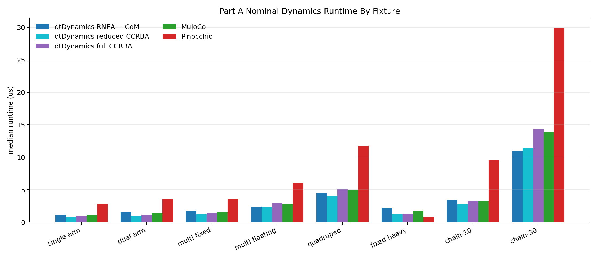
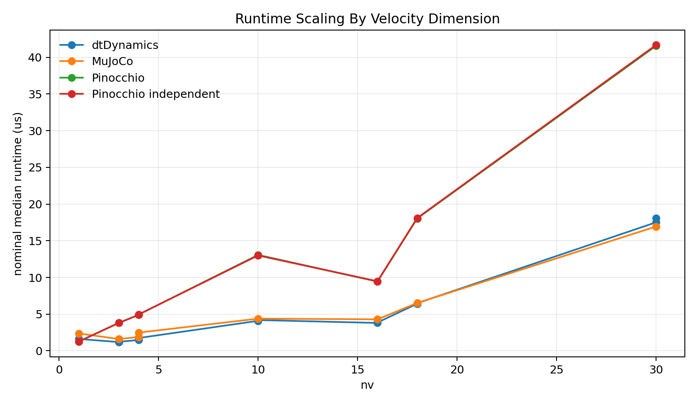
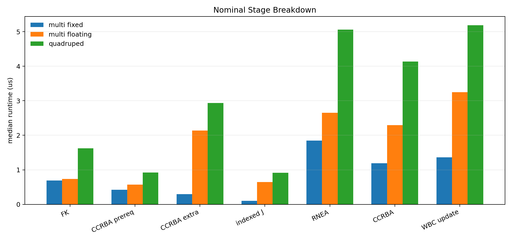
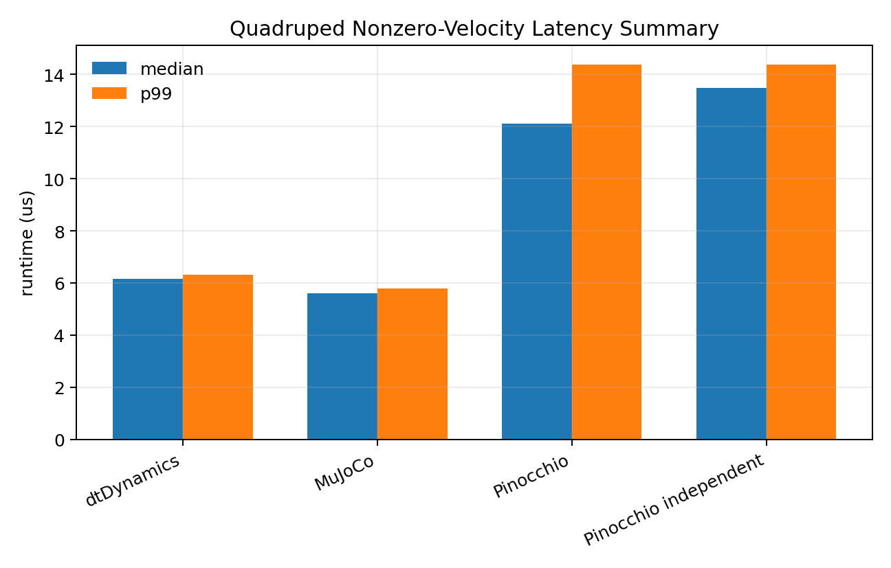

# dtDynamics Benchmark Results

Author: Joonhee Jo

Date: 2026-07-23

Updated: 2026-07-27 for expanded topology/scaling fixtures, p95 reporting, machine-readable figure CSVs, and refreshed CPU-affined native/stage evidence.

- 이 note가 기록하는 대상: 현재 native `dtDynamics` benchmark baseline과 reference-path timing pass
- reference benchmark가 사용하는 private validation cache 위치 (standalone package checkout 내부):
  - Package root: 이 standalone `dtDynamics` checkout
  - MuJoCo 3.8.0: `.validation_deps/mujoco-3.8.0`
  - Pinocchio 3.9.0: `.validation_deps/pinocchio-3.9.0`

- timing/error scope 설계 원칙: 의도적으로 명시적
- Native `dtDynamics`가 노출하는 explicit dynamics entry point: `ComputeDynamicsRNEA`(MuJoCo-step1-like base ingredient용), `ComputeDynamicsCCRBA`(base ingredient + `Cmat` + 선택적 centroidal output용)
- 미제공 항목: public `ComputeDynamics` alias
- RNEA 인자: `dtDynRneaTermFlags`; CCRBA 인자: `dtDynCcrbaTermFlags` (heavier optional centroidal output용)
- Jacobian timing 별도 보고 위치: `benchmark_dtDynamicsStages`
- MuJoCo, Pinocchio row 성격: overlapping ingredient에 대한 external reference call만 시간 측정 → 유용한 reference-path baseline이지만 아직 strict apples-to-apples algorithm comparison 아님
- reference benchmark 추가 출력: `comparison_reference,fixture,state,quantity,count,max_error,rms_error,status,diagnostic` 형식의 두 번째 CSV table

- derivative-style benchmark figure 범위: native `dtDynamics`가 이미 구현한 quantity로 한정 (`MmatDot`, `Cmat`, `Jdot`, `Jdot*qvel`, `cmAmatDot`, `comJmatDot`, 관련 spatial derivative)
- 참고한 스타일: [arXiv:2302.06001](https://arxiv.org/pdf/2302.06001)의 analytical dynamics-derivative work, [ROAM-Lab-ND/spatial_v2_extended](https://github.com/ROAM-Lab-ND/spatial_v2_extended)의 benchmark category
- 주의: 아직 second-order dynamics derivative 지원을 주장하지 않음

## Command

```bash
# Run from the standalone dtDynamics package root.
tools/audit_release_readiness.sh

cmake --preset validation
cmake --build --preset validation -- -j2
ctest --preset validation
export DTDYNAMICS_BENCHMARK_CPU=0
export DTDYNAMICS_BENCHMARK_BATCHES=7
taskset -c "$DTDYNAMICS_BENCHMARK_CPU" build/validation/bin/benchmark_dtDynamics > /tmp/native.csv
taskset -c "$DTDYNAMICS_BENCHMARK_CPU" build/validation/bin/benchmark_dtDynamicsStages > /tmp/stages.csv
taskset -c "$DTDYNAMICS_BENCHMARK_CPU" build/validation/bin/benchmark_dtDynamicsReferences > /tmp/references.csv
python3 tools/plot_benchmark_results.py \
  --native /tmp/native.csv \
  --stages /tmp/stages.csv \
  --references /tmp/references.csv \
  --out docs/figures
python3 tools/validate_reference_benchmark.py \
  --references /tmp/references.csv \
  --runtime-csv docs/figures/runtime_by_fixture.csv

DTDYNAMICS_BENCHMARK_ONLY_EXTERNAL=1 \
DTDYNAMICS_BENCHMARK_XML=/path/to/LeoQuad_QD1.xml \
DTDYNAMICS_BENCHMARK_XML_NAME=leoquad_qd1 \
  taskset -c "$DTDYNAMICS_BENCHMARK_CPU" \
  build/validation/bin/benchmark_dtDynamicsStages > /tmp/stages_leoquad.csv
```

- 이 run의 Validation status: `tools/audit_release_readiness.sh` 통과 (`test_dtDynTypes`, `test_dtDynamicsMujocoRef`, `test_dtDynamicsPinocchioRef`, install/export validation, release-invariant scan 포함)

- 중요 원칙: benchmark 숫자는 Release build에서만 획득
- 위험 사례: default single-config CMake build는 `CMAKE_BUILD_TYPE`이 비어 있어 native `dtDynamics`가 `-O` flag 없이 compile되는 반면 MuJoCo와 Pinocchio는 optimized prebuilt library → 이 unoptimized 구성에서는 native `dtDynamics`가 실제보다 대략 한 자릿수 느리게 보임

- validation configure 중 관찰되는 Pinocchio/Boost CMake warning 성격: production package warning 아님 (private Pinocchio validation prefix와 CMake의 Boost discovery policy/runtime-path diagnostics에서 발생)
- `benchmark_dtDynamicsReferences` 동작: build 및 완주, timing/error-summary CSV section 모두 출력, standalone package의 `.validation_deps` cache에서 MuJoCo/Pinocchio library resolve
- 이 warning들이 benchmark 사용을 차단하지 않는 조건: reference executable이 시작에 실패하거나 nonzero reference error를 보고하지 않는 한

- 모든 benchmark executable의 공통 마지막 섹션: `benchmark_metadata,key,value` CSV section
- 기록 항목: executable name, build type, compiler, C++ standard, platform, CPU model, hardware concurrency, clock source, clock steadiness, warmup iterations, measured iterations, batch count, `NDEBUG` status
- 배치 위치: timing/error row 이후 → 기존 timing parser가 header 기준으로 primary CSV section을 계속 소비 가능

- `DTDYNAMICS_BENCHMARK_BATCHES=N` 설정 용도: repeated-run aggregation
- `N > 1`일 때 추가 출력: `benchmark_batch_summary` row (per-batch mean/median/p95/p99 runtime의 min/median/max + batch 전체 최대 allocation count)
- plotting/report tool 처리 방식: 이 batch summary의 median을 human table, figure, normalized CSV에 승격 (raw first-batch timing row와 batch min/max spread는 source CSV에 유지)
- 지원 유지 대상: Historical 또는 default single-batch CSV

- 현재 timing evidence 조건: `DTDYNAMICS_BENCHMARK_BATCHES=7`, `taskset -c 0`, Intel Xeon w7-3545
- CPU 0 affinity 효과: process migration 방지 (단, host는 frequency locking·realtime priority 없이 `intel_pstate` `powersave` governor 상태 유지)
- 각 batch 수행 내용: 독립적으로 documented warmup과 measured iteration 수행
- seven-batch central value 의미: one-off scheduler/DVFS distortion 감소 (hard-realtime isolation 주장 아님)

- 각 batch 구성: warmup iteration 20회, measured iteration 200회
- Allocation count 측정 방식: 측정 대상 call이 active인 동안 global C++ `operator new` / `operator new[]`를 intercept
- 미포함 항목: `malloc`/`calloc`/`realloc`을 직접 경유하는 dtMath 또는 library allocation

- raw benchmark CSV 보존 항목: regression checking용 allocation counter
- Human-readable timing table 생략 조건: 해당 scope의 모든 표시 row가 0일 때 allocation column 생략 (zero allocation은 매 row 반복 대신 prose에 한 번만 명시)

## Expanded fixture and artifact pass (2026-07-27)

- 갱신된 native/stage pass 조건: GCC 11.4.0 (Linux 6.8.0)로 생성한 Release build, Intel Xeon w7-3545의 CPU 0에 고정
- batch 구성: 독립 batch 7회, 각 warmup 20회·measured iteration 200회
- CPU governor: `powersave` 유지 (frequency 미고정, realtime scheduling 미요청)
- 아래 값의 정의: seven per-batch median과 p95 summary의 median (pooled-sample percentile 아님)

- morphology identity 구성 (의도적으로 서로 구별):
  - `multi_robot_fixed_base`: 독립적인 world-fixed root 2개, articulated branch, nested fixed sensor frame, 다중 site/armature/actuator → branching/multi-root fixed-base fixture
  - `multi_robot_floating_base`: 독립적인 free-joint root 2개 + 별도 articulated branch + nested fixed sensor frame → 하나의 model에서 여러 floating tree 검증
  - `fixed_body_heavy`: world-fixed base 1개, nested fixed mount 8개, terminal hinge 1개 → body 11개이지만 velocity coordinate 1개로 mixed welded/jointed topology 격리
  - `serial_chain_10`, `serial_chain_30`: 명시적 10-DOF, 30-DOF scaling point로 사용되는 matched fixed-base serial chain

- 각 scope/stage batch 공통 절차: fixture compile, fresh `dtDynData` construct/resize, deterministic state 복원, 해당 row의 prerequisite 준비 후 warmup과 measurement
- 원칙: Stage row는 독립적 diagnostic (additive 아님)

| Fixture | nv | bodies | RNEA + CoM median / p95 us | Reduced CCRBA median / p95 us | Full CCRBA median / p95 us |
|---|---:|---:|---:|---:|---:|
| multi_robot_fixed_base | 4 | 8 | 2.275 / 2.351 | 1.548 / 1.590 | 1.740 / 1.777 |
| multi_robot_floating_base | 16 | 8 | 3.095 / 3.181 | 2.892 / 2.984 | 3.813 / 3.937 |
| fixed_body_heavy | 1 | 11 | 2.809 / 2.882 | 1.560 / 1.594 | 1.616 / 1.648 |
| serial_chain_10 | 10 | 12 | 4.357 / 4.492 | 3.412 / 3.515 | 4.105 / 4.204 |
| serial_chain_30 | 30 | 32 | 13.811 / 14.032 | 14.196 / 14.418 | 17.970 / 18.254 |

- 생성된 evidence family가 candidate에 포함된 위치: `docs/figures` 아래 `runtime_by_fixture.{csv,png}`, `scaling_by_dof.{csv,png}`, `stage_breakdown.{csv,png}`
- Narrow `.gitignore` exception 효과: 이 세 CSV만 deliverable로 유지 (다른 generated CSV는 계속 ignore)
- CSV row 보존 값: mean, median, p95, p99
- Figure 시각화 대상: median만 (tail 분석은 CSV 사용)
- `tools/validate_benchmark_results.py` fail-closed 조건: 필수 fixture/state/scope/stage 조합, percentile column, CSV, figure 중 하나라도 부재 시

## Part A — Native dynamics and reference scope

- Part A 구성: timing path 5종 (앞 3개는 package-native dynamics-only 호출, 뒤 2개는 external reference call sequence)
  - `native_rnea_com_pos`: `ComputeDynamicsRNEA(model, data, gravity, DTDYN_RNEA_TERM_COM_POS)`
  - `native_ccrba_reduced`: `ComputeDynamicsCCRBA(model, data, gravity, DTDYN_CCRBA_TERM_COM_POS | DTDYN_CCRBA_TERM_CMAMAT | DTDYN_CCRBA_TERM_CENT_MOM)`
  - `native_ccrba_all`: `ComputeDynamicsCCRBA(model, data, gravity, DTDYN_CCRBA_TERM_ALL)`
  - `mujoco`: 문서화된 MuJoCo forward/dynamics/reference sequence
  - `pinocchio`: 문서화된 Pinocchio dynamics/centroidal reference sequence

- MuJoCo와 Pinocchio 특성: 동일한 CCRBA output contract 미노출 → 이 row는 contextual reference timing일 뿐 same-output performance comparison 아님
- Numerical comparability 처리 위치: status-bearing reference-error row에서 별도 처리

- native CSV `scope` column 역할: package-native 호출 3종의 혼합 방지
- 포함 row 수: 72개 (fixture 8개 × state 3개 × scope 3개)
- RNEA 보고 방식: centroidal-matrix와 CoM-velocity consistency를 `nan`으로 보고
- reduced CCRBA 보고 방식: `centMom = cmAmat * qvel` 검증, CoM-velocity consistency는 `nan`
- full CCRBA 보고 방식: centroidal momentum과 `comVel = comJmat * qvel` 모두 검증

### Nominal Part A timing

| Fixture | RNEA + CoM median / p95 us | Reduced CCRBA median / p95 us | Full CCRBA median / p95 us | MuJoCo median / p95 us | Pinocchio median / p95 us |
|---|---:|---:|---:|---:|---:|
| single_manipulator_fixed_base | 1.521 / 1.581 | 1.070 / 1.113 | 1.229 / 1.271 | 1.592 / 1.634 | 3.806 / 3.883 |
| dual_manipulator_fixed_base | 1.896 / 1.953 | 1.324 / 1.368 | 1.501 / 1.552 | 1.884 / 1.948 | 4.853 / 4.938 |
| multi_robot_fixed_base | 2.275 / 2.351 | 1.548 / 1.590 | 1.740 / 1.777 | 2.470 / 2.534 | 4.876 / 4.973 |
| multi_robot_floating_base | 3.095 / 3.181 | 2.892 / 2.984 | 3.813 / 3.937 | 4.242 / 4.315 | 9.218 / 9.374 |
| quadruped_floating_base | 5.751 / 5.881 | 5.073 / 5.213 | 6.398 / 6.560 | 6.320 / 6.384 | 17.962 / 18.090 |
| fixed_body_heavy | 2.809 / 2.882 | 1.560 / 1.594 | 1.616 / 1.648 | 2.335 / 2.376 | 1.260 / 1.305 |
| serial_chain_10 | 4.357 / 4.492 | 3.412 / 3.515 | 4.105 / 4.204 | 4.352 / 4.426 | 13.010 / 13.145 |
| serial_chain_30 | 13.811 / 14.032 | 14.196 / 14.418 | 17.970 / 18.254 | 16.404 / 16.515 | 41.040 / 41.334 |

### Why `fixed_body_heavy` differs

- `fixed_body_heavy` 성격: fixed-topology stress fixture (representative high-DOF robot 아님)
- canonical `nbody=11`, `nq=1`, `nv=1` model 구성: world, world-fixed base 1개, nested fixed mount 8개, terminal revolute link 1개
- 질량: base 4.0, 각 fixed mount 0.05, terminal link 1.2
- fixture 검증 목적: 마지막 joint만 generalized coordinate를 기여함에도 engine이 긴 welded/fixed-body chain을 올바르게 처리하는지

- Native dtDynamics와 MuJoCo fixture: nested body topology 유지
- hand-built Pinocchio reference 방식: 8개 fixed offset을 하나의 placement로 합산하고 terminal revolute body만 instantiate (8개 fixed mount를 개별 순회하지 않음)
- 표시된 `nbody=11`의 의미: report metadata로 사용되는 canonical fixture count (Pinocchio의 internal recursion count 아님)
- 이 representation 차이의 결과: Pinocchio가 이 fixture에서 비정상적으로 빠름
- 해석 원칙: 이 timing은 engine-specific fixed-body representation behavior로 취급 (same-morphology throughput comparison 아님)
- Joint-space comparable quantity: 계속 validation target 유지
- semantically equivalent하지 않은 fixed-base centroidal row 처리: 이미 `status=skipped`로 출력

### Floating-base quadruped states

- 세 state의 성격: named controller mode가 아닌 deterministic coverage condition
  - `nominal`: model-default position, identity free/ball-joint orientation, zero generalized velocity
  - `asymmetric`: deterministic nonuniform position/orientation perturbation + zero generalized velocity (velocity term 없이 configuration-dependent path만 격리)
  - `nonzero_velocity`: 자체 deterministic perturbed pose + nonzero free/ball/scalar-joint velocity → velocity-dependent Coriolis, bias, `MmatDot`, centroidal-derivative path 활성화 (asymmetric state에 velocity만 단순 추가한 것 아님)

- 각 engine adapter 적용 방식: coordinate mapping을 통해 위 semantics 적용 → contextual timing row를 하나의 공유 raw `qpos` memory layout으로 해석 금지

| State | RNEA + CoM median / p95 us | Reduced CCRBA median / p95 us | Full CCRBA median / p95 us | MuJoCo median / p95 us | Pinocchio median / p95 us |
|---|---:|---:|---:|---:|---:|
| nominal | 5.751 / 5.881 | 5.073 / 5.213 | 6.398 / 6.560 | 6.320 / 6.384 | 17.962 / 18.090 |
| asymmetric | 5.877 / 6.032 | 5.182 / 5.310 | 6.518 / 6.685 | 7.000 / 7.072 | 18.367 / 18.511 |
| nonzero_velocity | 6.049 / 6.187 | 6.907 / 7.045 | 8.166 / 8.293 | 7.039 / 7.119 | 18.364 / 18.507 |

- 세 native scope 공통 결과: mass-matrix symmetry와 `nonlinTorq = coriolisTorq + gravityTorq` consistency error가 benchmark output precision에서 0
- Reduced/full CCRBA 추가 결과: centroidal-momentum consistency error 0
- full CCRBA 추가 결과: CoM-velocity consistency error 0
- MuJoCo/Pinocchio timing 해석: 여전히 contextual (same-output speed ratio 아님) — call sequence가 모든 native CCRBA output을 동일 형태로 계산하지 않기 때문
- 주된 역할: 문서화된 overlap set에 대한 numerical validation

#### Nominal runtime by fixture



- `runtime_by_fixture.png` 성격: Part A table의 nominal median row를 grouped-bar로 시각화
- 각 fixture group 구성: dtDynamics 호출 3종 + MuJoCo + Pinocchio
- 낮은 bar의 의미: 이 host에서 해당 measured call sequence의 elapsed time이 적음
- RNEA, reduced CCRBA, full CCRBA 간 격차의 의미: 점진적으로 다른 native output을 요청하는 비용
- MuJoCo/Pinocchio bar 성격: output contract가 동일하지 않으므로 contextual 유지
- Tail behavior 표현 위치: 이 median-only figure가 아닌 table의 p95 column

#### Runtime scaling by velocity dimension



- `scaling_by_dof.png` 내용: 같은 nominal median을 `nv`에 대해 plot
- marker 단위: fixture별로 상이 → 연결선은 fitted complexity curve가 아닌 visual guide
- 주의: `nv`가 같다고 작업량이 같은 것은 아님 (floating-base topology, body count, fixed body, site, requested output에 따라 runtime 변동)
- 용도: 이 plot으로 대략적인 size trend 확인, 정확한 morphology-aware 비교는 fixture table 사용

### Native stage breakdown

- `benchmark_dtDynamicsStages` 구성: native pipeline을 public API stage와 internal CCRBA/RNEA substage로 분할
- 각 stage 시작점: 해당 API가 필요로 하는 prerequisite state → row는 diagnostic timing (additive exclusive profiler sample 아님)

- `CCRBA prereq` (`ccrba_prerequisites_after_fk`) 전제: forward kinematics 완료 상태
  - 계산 항목: subtree CoM 값, DOF motion subspace(`cdof`), body spatial velocity와 motion-subspace derivative(`cvel`, `cdof_dot`), body/composite spatial inertia(`cinert`, `crb`), local/accumulated velocity-bias matrix, downstream CCRBA output이 재사용하는 per-DOF `f1`/`f2`/`f3` force column
  - zero-velocity 최적화: `cvel`, `cdof_dot`가 정확히 0일 때 bias work를 skip

- `CCRBA extra` (`ccrba_extended_after_prereq`) 전제: 위 prerequisite 완료 상태
  - 동작: dense output buffer clear 후 root CoM, `cmAmat`, `cmAmatDot`, `Mmat`, `MmatDot`, `Cmat`, `comJmat`, `comJmatDot`, `centMom`, `comVel`, `coriolisTorq` materialize
  - 제외 대상: forward kinematics, prerequisite stage 자체, full public call의 gravity/nonlinear bias-force 마무리 작업

- `CCRBA after FK` 측정 방식: `CCRBA prereq` 다음 `CCRBA extra`를 독립적으로 측정 (FK는 timer 밖에서 준비)
- `CCRBA all` 측정 대상: 자체 FK와 gravity/nonlinear bias-force 작업을 포함한 complete public all-terms call
- 원칙: 각 row가 독립적으로 준비·측정되므로 표시된 median을 더해 다른 row를 재구성 금지

- setup-only `benchmark_dtDynamics` resource row(`dtDynModel_resource`, `dtDynData_resource`) 검사 대상: realtime loop 밖의 model compilation과 data resize 비용
- 포함 이유: setup cost를 명시적으로 드러내기 위함 (controller update timing에는 미포함)
- `Resize allocations` 의미: fresh `dtDynData::Resize(model)` path 1회당 counted C++ global allocation call 수 (시간이 아닌 count)
- 반복된 200회 resize iteration 각각 31회로 계측 → 정수 하나로 충분
- Requested allocation bytes: raw CSV에 유지되나 timing 해석에 불필요하여 여기서는 생략

| Fixture | nq | nv | bodies | Compile median us | Compile p99 us | Data resize median us | Data resize p99 us | Resize allocations |
|---|---:|---:|---:|---:|---:|---:|---:|---:|
| single_manipulator_fixed_base | 3 | 3 | 5 | 1.444 | 2.401 | 1.552 | 3.090 | 31 |
| dual_manipulator_fixed_base | 4 | 4 | 6 | 1.725 | 1.819 | 1.804 | 2.359 | 31 |
| multi_robot_fixed_base | 4 | 4 | 8 | 2.202 | 2.554 | 1.988 | 3.611 | 31 |
| multi_robot_floating_base | 18 | 16 | 8 | 2.659 | 4.525 | 2.942 | 3.341 | 31 |
| quadruped_floating_base | 19 | 18 | 14 | 5.263 | 11.240 | 4.249 | 4.983 | 31 |
| fixed_body_heavy | 1 | 1 | 11 | 2.122 | 3.353 | 2.229 | 2.878 | 31 |
| serial_chain_10 | 10 | 10 | 12 | 2.879 | 4.030 | 3.219 | 5.120 | 31 |
| serial_chain_30 | 30 | 30 | 32 | 10.332 | 14.655 | 8.491 | 11.730 | 31 |

- 측정된 steady-state dynamics/stage row 결과: counted C++ `operator new` allocation 0
- 의미: 측정된 compute scope를 setup과 구분 (완전한 heap-allocation proof는 아님 — dtMath container나 external library가 이 counter 밖의 `malloc`-family path 사용 가능)

- floating-base quadruped fixture의 median stage time (microsecond):

| State | FK | Mass after FK | CCRBA after FK | CCRBA prereq | CCRBA extra | Body Jacobians | Site Jacobians | All Jacobians | Indexed Jacobians | Gravity | RNEA + CoM | CCRBA all |
|---|---:|---:|---:|---:|---:|---:|---:|---:|---:|---:|---:|---:|
| nominal | 1.589 | 1.272 | 3.681 | 0.886 | 2.730 | 2.035 | 0.690 | 3.035 | 0.872 | 0.054 | 4.598 | 5.126 |
| asymmetric | 1.682 | 1.318 | 3.858 | 0.908 | 2.982 | 1.971 | 0.709 | 3.081 | 0.868 | 0.054 | 4.432 | 5.053 |
| nonzero_velocity | 1.543 | 1.312 | 5.257 | 2.070 | 2.795 | 1.871 | 0.688 | 3.079 | 0.836 | 0.047 | 4.369 | 6.095 |

- multi-root fixture 대상 focused run 목적: 독립 model part + fixed sensor frame의 timing path 검증
- median stage time (microsecond):

| Fixture | State | FK | Mass after FK | CCRBA after FK | CCRBA prereq | CCRBA extra | Indexed Jacobians | RNEA + CoM | CCRBA all | Reduced WBC update |
|---|---|---:|---:|---:|---:|---:|---:|---:|---:|---:|
| multi_robot_fixed_base | nominal | 0.668 | 0.454 | 0.745 | 0.416 | 0.284 | 0.099 | 1.798 | 1.373 | 1.335 |
| multi_robot_fixed_base | asymmetric | 0.695 | 0.451 | 0.743 | 0.419 | 0.284 | 0.099 | 1.831 | 1.408 | 1.379 |
| multi_robot_fixed_base | nonzero_velocity | 0.702 | 0.468 | 1.138 | 0.802 | 0.284 | 0.098 | 1.867 | 1.817 | 1.783 |
| multi_robot_floating_base | nominal | 0.719 | 0.838 | 2.722 | 0.558 | 2.142 | 0.572 | 2.444 | 2.990 | 2.962 |
| multi_robot_floating_base | asymmetric | 0.752 | 0.857 | 2.891 | 0.605 | 2.166 | 0.612 | 2.495 | 3.044 | 3.059 |
| multi_robot_floating_base | nonzero_velocity | 0.748 | 1.038 | 3.878 | 1.430 | 2.185 | 0.575 | 2.578 | 3.920 | 3.908 |

#### Nominal stage breakdown figure



- `stage_breakdown.png` 비교 대상: fixed-base multi-robot, floating-base multi-robot, floating-base quadruped fixture의 독립 측정된 nominal stage
- 주의: stacked profile 아님 — 각 bar가 위에서 정의한 prerequisite state에서 시작하므로 bar를 합산해 public call을 재구성 금지
- `indexed J`: dynamics 준비 후 선택된 Jacobian 측정
- `RNEA + CoM`, `CCRBA all`, `reduced CCRBA`: 명시된 mask를 가진 complete dynamics call
- `reduced + indexed J`: reduced CCRBA 후 선택된 body/site Jacobian 추가
- fixture 간 격차의 의미: `nv`뿐 아니라 topology와 requested-work 차이 반영

## Part B — LeoQuad controller scope

- Part B 적용 방식: Part A에서 정의한 동일 reduced CCRBA mask를 canonical LeoQuad model에 적용 후 controller-selected indexed Jacobian 추가

```cpp
constexpr dtDynCcrbaTermFlags leoquadMask =
    DTDYN_CCRBA_TERM_COM_POS |
    DTDYN_CCRBA_TERM_CMAMAT |
    DTDYN_CCRBA_TERM_CENT_MOM;

ComputeDynamicsCCRBA(model, data, gravity, leoquadMask);
ComputeJacobians(model, data, bodyIds, siteIds);
```

- `bodyIds` 구성: root/base body
- `siteIds` 구성: foot site 4개
- dynamics-only reduced call 라벨: `leoquad_reduced_ccrba`
- combined controller-shaped call 라벨: `leoquad_wbc_update`
- 아래 seven-batch central median 조건: canonical current `leoquad-control/model/LeoQuad_QD1.xml` fixture, batch당 measured iteration 200회
- 성격: evidence snapshot (platform-independent guarantee 아님)

| State | CCRBA all median us | RNEA + CoM median us | Reduced CCRBA median us | Reduced CCRBA + indexed Jacobians median us |
|---|---:|---:|---:|---:|
| nominal | 6.383 | 5.845 | 5.162 | 7.501 |
| asymmetric | 6.529 | 5.922 | 5.255 | 7.630 |
| nonzero_velocity | 8.240 | 6.038 | 6.917 | 9.213 |

- External fixture 성격: `DTDYNAMICS_BENCHMARK_XML`로 opt-in 유지
- `DTDYNAMICS_BENCHMARK_ONLY_EXTERNAL=1`: 해당 XML로만 run 제한
- `DTDYNAMICS_BENCHMARK_XML_NAME`: CSV fixture label 지정
- 결과: standalone package는 LeoQuad asset에 미의존

- CCRBA bias-force assembly 최적화 이력 (아래 각 항목을 순서대로 적용): temporary 6x6 cross-matrix construction을 direct sparse cross-term accumulation으로 교체, 불필요한 local `Bmat` scratch array 제거, local bias를 `BmatComp`에 직접 계산, public CCRBA `Cmat*qvel` product를 `Cmat` fill loop에 fuse, zero-velocity local bias construction skip, zero bias-force product skip, 불필요한 nonzero-body inertia clear 회피, local motion-cross update를 spatial-inertia column 기준으로 grouping, paired DOF 6x6-vector product 결합, body spatial inertia를 in-place로 직접 fill, scaled spatial temporary를 in-place scaled add로 교체, compiled body/inertial/site rotation matrix caching, controller-selected body/site Jacobian용 data-internal combined indexed `J`/`Jdot` writer 사용, diff-motion zeroing을 정확한 write site로 이동하며 exact-zero cross-product skip 추가, `cdof`와 nonzero `cdof_dot`를 직접 기록, benchmark로 유의미한 regression 없음을 확인한 뒤 local momentum multiply를 `ComputeBiasMatrix` 내부에서 dtMath operator form으로 유지, per-body `BmatCompNonzero` flag를 composite bias accumulation 전반에 전달, 해당 flag가 read를 막을 때 불필요한 `BmatComp` clear skip, zero-derivative DOF bias product를 `SpatialMulInto`로 `f2`에 직접 기록, DOF bias-force path의 fixed-size 6x6 spatial matrix-vector product unroll
- 위 최적화 배치 이전에 기록된 historical optimization batch-summary median:

| State | CCRBA prereq | Local bias matrices | Bias accumulation | DOF bias forces | CCRBA bias forces | WBC CCRBA Terms | LeoQuad WBC Update |
| --- | ---: | ---: | ---: | ---: | ---: | ---: | ---: |
| nominal | 0.940 | 0.063 | 0.027 | 0.194 | 0.251 | 4.235 | 6.210 |
| asymmetric | 0.991 | 0.064 | 0.027 | 0.194 | 0.251 | 4.404 | 6.503 |
| nonzero_velocity | 2.248 | 0.798 | 0.114 | 0.546 | 1.531 | 5.831 | 7.830 |

- 현재 optimization pass 중단 사유: readability 보존
- 다음 가능한 target: 남은 nonzero local-bias matrix row (단, 추가 축소하려면 읽기 쉬운 `ComputeBiasMatrix` assembly helper를 더 큰 hand-expanded formula로 교체해야 할 가능성)

- `SIMROBOT_PROFILE_DYNAMICS=1`로 profiled headless LeoQuad trot validation run 보고 대상: 실제 control path에서 측정한 `Robot::UpdateDynamics` timing
- controller-facing copy helper의 불필요한 exact-size zeroing 제거 후 현재 validation run:

| samples | mean us | min us | max us | last us |
|---:|---:|---:|---:|---:|
| 20103 | 15.589 | 11.131 | 163.781 | 12.415 |

- 같은 run이 방출한 opt-in split timing:

| input mean us | native mean us | export mean us | input last us | native last us | export last us |
|---:|---:|---:|---:|---:|---:|
| 0.132 | 12.663 | 2.794 | 0.141 | 10.190 | 2.084 |

- native block 추가 분할:

| CCRBA mean us | Jacobian mean us | CCRBA last us | Jacobian last us |
|---:|---:|---:|---:|
| 10.232 | 2.432 | 8.219 | 1.971 |

- `input` 측정 범위: qpos/qvel staging, local `qVel` copy, gravity setup
- `native` 측정 범위: reduced `ComputeDynamicsCCRBA` 호출 + indexed body/site `ComputeJacobians`
- `export` 측정 범위: 계산된 `dtDynData` field를 기존 controller-facing member와 derived base/task quantity로 복사하는 LeoQuad 측 작업
- split이 보여주는 것: 실제 LeoQuad model/state에서 남은 주요 runtime 비용은 여전히 reduced CCRBA
- 유지된 최적화 효과: direct bias-force assembly, local-scratch cleanup, compiled rotation cache, combined indexed Jacobian writer, diff-motion zero fast path, composite bias nonzero flag, no-temporary DOF bias product → 최신 isolated-prefix headless CCRBA mean을 약 10.2 us로 유지, native benchmark row에서 측정된 allocation 없음

- CCRBA extended stage 추가 분할:

| State | Dense clear | Root CoM | CMM/CMMdot | Mmat | MmatDot | Cmat | CoM J/Jdot | CMM*qvel | CoM J*qvel | Cmat*qvel | Combined products |
|---|---:|---:|---:|---:|---:|---:|---:|---:|---:|---:|---:|
| nominal | 0.105 | 0.023 | 0.148 | 0.347 | 0.598 | 0.717 | 0.170 | 0.207 | 0.131 | 0.533 | 0.817 |
| asymmetric | 0.115 | 0.024 | 0.150 | 0.344 | 0.618 | 0.689 | 0.169 | 0.203 | 0.126 | 0.501 | 0.775 |
| nonzero_velocity | 0.105 | 0.023 | 0.146 | 0.346 | 0.597 | 0.689 | 0.169 | 0.202 | 0.126 | 0.500 | 0.776 |

- `Combined products` 성격: `centMom = cmAmat * qvel`, `comVel = comJmat * qvel`, standalone diagnostic `coriolisTorq = Cmat * qvel` 세 matrix-vector product를 순차 실행하는 하나의 timed stage
- 주의: 네 번째 mathematical output이 아니며, 각 row가 독립적인 timer/cache 효과를 가지므로 측정된 median이 별도로 측정된 세 median의 산술 합과 같을 필요 없음

- `Cmat*qvel` row 유지 위치: stage benchmark의 diagnostic standalone product
- public `ComputeDynamicsCCRBA` path의 개선: 이 별도 dense pass 비용을 더 이상 지불하지 않음 — `Cmat`을 채우면서 `coriolisTorq`를 accumulate한 뒤 `nonlinTorq = gravityTorq + coriolisTorq` 구성

- 이전 top-level spatial-array pre-clear 제거 근거: downstream stage가 spatial work array(`cdof`, `cdof_dot`, `cvel`, `cinert`, `crb`, `BmatComp`, `f1/f2/f3`)를 덮어쓰는 것을 확인
- Dense output matrix clearing 유지 이유: `Mmat`, `MmatDot`, `Cmat`의 non-ancestor entry는 parent-chain loop가 의도적으로 기록하지 않으므로 0으로 유지 필요

- Fresh seven-batch central CCRBA-all nominal median: single manipulator fixed base 1.002 us, dual manipulator fixed base 1.172 us, multi robot fixed base 1.373 us, multi robot floating base 2.990 us, `fixed_body_heavy` 1.169 us
- 모든 측정된 stage compute row 결과: counted C++ `operator new` allocation 0 (raw stage CSV는 regression check용 allocation counter 유지)

- 이 결과가 설명하는 것: 남은 native-vs-MuJoCo timing 차이 대부분
- `DTDYN_CCRBA_TERM_ALL` 계산 범위: MuJoCo overlap set을 넘어서는 controller-specific quantity
- package-native `native_ccrba_reduced` scope 요청 범위: `COM_POS`, `CMAMAT`, `CENT_MOM`만
- Part B 적용 방식: 같은 mask를 canonical LeoQuad model에 `leoquad_reduced_ccrba`로 적용
- stage benchmark 추가 포함: `leoquad_wbc_update` (reduced CCRBA 호출 후 indexed body/site `ComputeJacobians` 실행으로 LeoQuad runtime order와 일치)
- native `compute_dynamics_rnea_com_pos` stage 특성: `DTDYN_RNEA_TERM_COM_POS` 사용, MuJoCo의 bias-force path에 더 가까움, CCRBA matrix 회피
- CCRBA의 gravity/Coriolis/nonlinear torque ingredient 계산 방식: RNEA 호출 대신 centroidal/`Cmat` pass에서 계산
- extended substage 특성: dense output clearing은 작음; `Cmat`과 `MmatDot`이 주요 per-term matrix cost; standalone `Cmat*qvel` row는 이제 public CCRBA entry point가 회피하는 diagnostic cost
- prerequisite substage 특성: zero-velocity state가 훨씬 저렴해짐 (local bias matrix와 zero bias product를 정확히 skip, `BmatCompNonzero`가 known-zero composite bias matrix의 scan/accumulation 회피, zero-derivative DOF bias product가 반환된 temporary 없이 `f2`에 직접 기록)
- Nonzero velocity state 특성: 여전히 실제 local-bias cost 지불하지만, grouped local motion-cross update로 이 row가 현재 real XML fixture에서 대략 1.5 us에서 0.8 us로 감소
- Readability pass 내용: benchmark로 유의미한 regression 없음을 확인한 뒤 local momentum calculation을 dtMath `inertia * velocity` operator form으로 복원
- Direct in-place spatial inertia filling 효과: composite inertia row를 약 0.5 us로 감소
- in-place scaled add + direct `cdof`/`cdof_dot` spatial write 효과: prerequisite path에서 작은 temporary 제거
- DOF bias-force path의 fixed-size spatial matrix-vector kernel unroll 근거: 이 product가 항상 6x6이기 때문
- Jacobian computation 분리 방식: dynamics computation과 별도로 분리
- indexed Jacobian overload 계산 범위: 요청된 root/base body Jacobian + task-site Jacobian만
- quadruped fixture에서의 효과: Jacobian median time을 약 3.7 us에서 약 1.05-1.07 us로 감소 (counted C++ `operator new` allocation 없음, raw CSV는 zero allocation counter 유지)
- Public `ComputePointJacobianTerms`, `ComputeBodyJacobianTerms`, `ComputeSiteJacobianTerms` wrapper 용도: `J`, `Jdot`, `Jdot*qvel`이 함께 필요한 one-off task request 처리
- Site-only Jacobian timing 성격: diagnostic lower bound로 유용 (base body Jacobian이 controller input으로 남아있는 한 LeoQuad runtime contract는 아님)

## Reference and validation scope

- MuJoCo 3.8.0 timing scope 정확한 범위: `mj_forward`, `mj_subtreeVel`, `mj_fullM`, site당 `mj_jacSite` 1회 + `mj_jacDot` 1회, world-root subtree당 `mj_jacSubtreeCom` 1회 + `mj_angmomMat` 1회
- 이 timing lambda가 소유하는 대상: `mjModel`, `mjData`, MuJoCo scratch buffer만

- Pinocchio 3.9.0 timing scope 정확한 범위: `crba`, lower-triangle mass-matrix completion, `computeGeneralizedGravity`, `nonLinearEffects`, `computeCoriolisMatrix`, `ccrba`, `computeCentroidalMapTimeVariation`, `computeCentroidalMomentumTimeVariation`
- 이 timing lambda가 소유하는 대상: hand-built Pinocchio model/data와 coordinate-adapter scratch만

- native context row 측정 방식: `ComputeDynamicsCCRBA(..., DTDYN_CCRBA_TERM_ALL)`로 독립 측정
- 성격: 어느 external timing lambda에서도 호출되지 않으며 두 external sequence 중 어느 것과도 동일한 output contract를 갖지 않음
- benchmark가 metadata에 기록하는 Release-active independence oracle: `mujoco_native_validation_runs_during_timing=0`, `pinocchio_native_validation_runs_during_timing=0`
- numerical comparison용 native run 실행 시점: 대응하는 external timing section 이후에만
- 결론: 이 값들은 library-overhead context (same-output speed ratio 아님)

- `tools/validate_reference_benchmark.py` 검사 항목: Release/seven-batch timing policy, 72개 timing key와 exact quantity scope 전체, 72개 seven-batch summary key 전체, finite ordered min/median/max field, promoted median/p95/p99 ordering, `runtime_by_fixture.csv`의 48개 external promoted row에 대한 exact agreement와 unique full engine × fixture × state coverage, 두 zero-valued independence oracle, Release-active non-finite-policy self-test, 528개 comparison row 전체, finite error/tolerance field, exact `465 ok / 63 skipped / 0 fail` status split, 통과 row마다 양수 sample count, skip row마다 nonempty diagnostic과 zero compared sample

| Engine | Fixture | State | nq | nv | bodies | mean us | median us | p95 us |
| --- | --- | ---: | ---: | ---: | ---: | ---: | ---: | ---: |
| mujoco | single_manipulator_fixed_base | nominal | 3 | 3 | 5 | 1.597670 | 1.592000 | 1.634000 |
| mujoco | single_manipulator_fixed_base | asymmetric | 3 | 3 | 5 | 1.728520 | 1.723000 | 1.774000 |
| mujoco | single_manipulator_fixed_base | nonzero_velocity | 3 | 3 | 5 | 1.726240 | 1.722000 | 1.773000 |
| mujoco | dual_manipulator_fixed_base | nominal | 4 | 4 | 6 | 1.891750 | 1.884000 | 1.948000 |
| mujoco | dual_manipulator_fixed_base | asymmetric | 4 | 4 | 6 | 2.056880 | 2.053000 | 2.117000 |
| mujoco | dual_manipulator_fixed_base | nonzero_velocity | 4 | 4 | 6 | 2.060970 | 2.061000 | 2.131000 |
| mujoco | multi_robot_fixed_base | nominal | 4 | 4 | 8 | 2.481840 | 2.470000 | 2.534000 |
| mujoco | multi_robot_fixed_base | asymmetric | 4 | 4 | 8 | 2.614520 | 2.602000 | 2.665000 |
| mujoco | multi_robot_fixed_base | nonzero_velocity | 4 | 4 | 8 | 2.620250 | 2.603000 | 2.664000 |
| mujoco | multi_robot_floating_base | nominal | 18 | 16 | 8 | 4.253380 | 4.242000 | 4.315000 |
| mujoco | multi_robot_floating_base | asymmetric | 18 | 16 | 8 | 4.365160 | 4.347000 | 4.429000 |
| mujoco | multi_robot_floating_base | nonzero_velocity | 18 | 16 | 8 | 4.567630 | 4.556000 | 4.632000 |
| mujoco | quadruped_floating_base | nominal | 19 | 18 | 14 | 6.340220 | 6.320000 | 6.384000 |
| mujoco | quadruped_floating_base | asymmetric | 19 | 18 | 14 | 7.021800 | 7.000000 | 7.072000 |
| mujoco | quadruped_floating_base | nonzero_velocity | 19 | 18 | 14 | 7.054600 | 7.039000 | 7.119000 |
| mujoco | fixed_body_heavy | nominal | 1 | 1 | 11 | 2.340090 | 2.335000 | 2.376000 |
| mujoco | fixed_body_heavy | asymmetric | 1 | 1 | 11 | 2.380520 | 2.378000 | 2.428000 |
| mujoco | fixed_body_heavy | nonzero_velocity | 1 | 1 | 11 | 2.379740 | 2.364000 | 2.419000 |
| mujoco | serial_chain_10 | nominal | 10 | 10 | 12 | 4.359390 | 4.352000 | 4.426000 |
| mujoco | serial_chain_10 | asymmetric | 10 | 10 | 12 | 4.868060 | 4.857000 | 4.922000 |
| mujoco | serial_chain_10 | nonzero_velocity | 10 | 10 | 12 | 4.863120 | 4.851000 | 4.925000 |
| mujoco | serial_chain_30 | nominal | 30 | 30 | 32 | 16.451600 | 16.404000 | 16.515000 |
| mujoco | serial_chain_30 | asymmetric | 30 | 30 | 32 | 18.344700 | 18.276000 | 18.419000 |
| mujoco | serial_chain_30 | nonzero_velocity | 30 | 30 | 32 | 18.376200 | 18.276000 | 18.456000 |
| pinocchio | single_manipulator_fixed_base | nominal | 3 | 3 | 5 | 3.823410 | 3.806000 | 3.883000 |
| pinocchio | single_manipulator_fixed_base | asymmetric | 3 | 3 | 5 | 3.951150 | 3.932000 | 4.004000 |
| pinocchio | single_manipulator_fixed_base | nonzero_velocity | 3 | 3 | 5 | 3.953860 | 3.930000 | 4.019000 |
| pinocchio | dual_manipulator_fixed_base | nominal | 4 | 4 | 6 | 4.876290 | 4.853000 | 4.938000 |
| pinocchio | dual_manipulator_fixed_base | asymmetric | 4 | 4 | 6 | 5.005310 | 4.983000 | 5.061000 |
| pinocchio | dual_manipulator_fixed_base | nonzero_velocity | 4 | 4 | 6 | 4.999700 | 4.986000 | 5.054000 |
| pinocchio | multi_robot_fixed_base | nominal | 4 | 4 | 8 | 4.891490 | 4.876000 | 4.973000 |
| pinocchio | multi_robot_fixed_base | asymmetric | 4 | 4 | 8 | 5.048880 | 5.027000 | 5.100000 |
| pinocchio | multi_robot_fixed_base | nonzero_velocity | 4 | 4 | 8 | 5.046500 | 5.028000 | 5.098000 |
| pinocchio | multi_robot_floating_base | nominal | 18 | 16 | 8 | 9.256910 | 9.218000 | 9.374000 |
| pinocchio | multi_robot_floating_base | asymmetric | 18 | 16 | 8 | 9.417450 | 9.388000 | 9.516000 |
| pinocchio | multi_robot_floating_base | nonzero_velocity | 18 | 16 | 8 | 9.429050 | 9.406000 | 9.531000 |
| pinocchio | quadruped_floating_base | nominal | 19 | 18 | 14 | 17.993400 | 17.962000 | 18.090000 |
| pinocchio | quadruped_floating_base | asymmetric | 19 | 18 | 14 | 18.434000 | 18.367000 | 18.511000 |
| pinocchio | quadruped_floating_base | nonzero_velocity | 19 | 18 | 14 | 18.435200 | 18.364000 | 18.507000 |
| pinocchio | fixed_body_heavy | nominal | 1 | 1 | 11 | 1.265070 | 1.260000 | 1.305000 |
| pinocchio | fixed_body_heavy | asymmetric | 1 | 1 | 11 | 1.295650 | 1.288000 | 1.340000 |
| pinocchio | fixed_body_heavy | nonzero_velocity | 1 | 1 | 11 | 1.297440 | 1.288000 | 1.343000 |
| pinocchio | serial_chain_10 | nominal | 10 | 10 | 12 | 13.070600 | 13.010000 | 13.145000 |
| pinocchio | serial_chain_10 | asymmetric | 10 | 10 | 12 | 13.444600 | 13.386000 | 13.517000 |
| pinocchio | serial_chain_10 | nonzero_velocity | 10 | 10 | 12 | 13.436400 | 13.381000 | 13.527000 |
| pinocchio | serial_chain_30 | nominal | 30 | 30 | 32 | 41.178000 | 41.040000 | 41.334000 |
| pinocchio | serial_chain_30 | asymmetric | 30 | 30 | 32 | 42.369900 | 42.224000 | 42.477000 |
| pinocchio | serial_chain_30 | nonzero_velocity | 30 | 30 | 32 | 42.331400 | 42.203000 | 42.469000 |

### Quadruped nonzero-velocity latency summary



- 이 figure 요약 대상: reference benchmark의 floating-base quadruped nonzero-velocity row의 median/p95 latency
- 배치 방식: dtDynamics full-output context call을 MuJoCo, canonical Pinocchio call sequence와 나란히 배치 (same-output comparison 또는 three-native-scope Part A figure 아님)
- Median bar 의미: 전형적인 measured latency
- p95 bar 의미: CPU-affined seven-batch evidence에서 관측된 tail
- 주의: Affinity는 migration을 방지하지만 CPU frequency lock이나 realtime scheduling은 제공하지 않음

## Reference Error Summary

- `benchmark_dtDynamicsReferences` 추가 출력: timing table 이후 numerical error row
- `status=ok` row 성격: numerical comparison
- `status=skipped` row 성격: 의도적으로 non-comparable한 quantity의 explicit diagnostic

- Reference-error figure 미생성 이유: residual이 floating-point roundoff scale
- Fresh CSV의 error/tolerance field 표기: 6자리 소수점 반올림 대신 17-digit scientific notation
- `status=ok` row 전체에서 관측된 최대 absolute error: MuJoCo `5.684341886080802e-14`, Pinocchio `2.8421709430404007e-13`
- 이전 `0.000000` 표시값의 의미: "6-decimal output resolution 미만" (mathematical identity 아님)
- Status 계산 방식: serialization 전 unrounded residual을 per-reference absolute/relative tolerance policy와 비교
- fail-closed 조건: actual, expected, residual, accumulated-square, RMS, tolerance 값 중 non-finite 값 존재 시
- 매 Release benchmark run마다 수행: `NaN`과 infinity를 probe하는 startup self-test

- MuJoCo comparison 대상:
  - `Mmat`
  - `gravityTorq`, `coriolisTorq`, `nonlinTorq`
  - `cdof`, `cdof_dot`, `cvel`
  - site `jacp`, `jacr`, `jacp_dot`, `jacr_dot`
  - `subtree_com`, `comJmat`, `cmAmat`, `centMom`

- 이 run에서 MuJoCo comparison row 360개 전체: policy 범위 내
- `multi_robot_fixed_base` fixture 추가 구성: 독립 world-root body 2개, fixed sensor frame, 다중 site, limited joint, armature, actuator
- `multi_robot_floating_base` fixture 추가 구성: 독립 free-joint root 2개 + 별도 articulated branch
- MuJoCo model-parity test 추가 확인 항목 (이 multi-root case용): `nroot`, `root_bodyid`, `root_mass`, body별 `body_rootidx`

- Pinocchio comparison 대상:
  - `Mmat`
  - `gravityTorq`, `coriolisTorq`, `nonlinTorq`
  - floating-base quadruped `cmAmat`, `centMom`, `cmAmatDot*qvel`
  - floating-base multi-robot `Mmat`, `gravityTorq`, `coriolisTorq`, `nonlinTorq`

- Pinocchio `status=ok` row 105개 전체: policy 범위 내
- fixed-base multi-robot Pinocchio reference 특성: matching armature 값 포함 → mass matrix가 MuJoCo/native fixture와 비교 가능
- multi-floating Pinocchio reference 특성: 두 독립 root 모두에 explicit free-joint qpos/qvel map 사용 → whole-system mass, gravity, nonlinear, Coriolis term이 native `dtDynamics`와 비교 가능
- equivalent contract 없는 centroidal row 63개 처리: `status=skipped`, `count=0`, passing으로 미집계, diagnostic 유지
  - 사유: multi-root native centroidal output은 per-root stacked인 반면 Pinocchio는 whole-system 값 노출; fixed-base XML fixture는 hand-built Pinocchio model에서 생략된 world-fixed inertial body 포함
