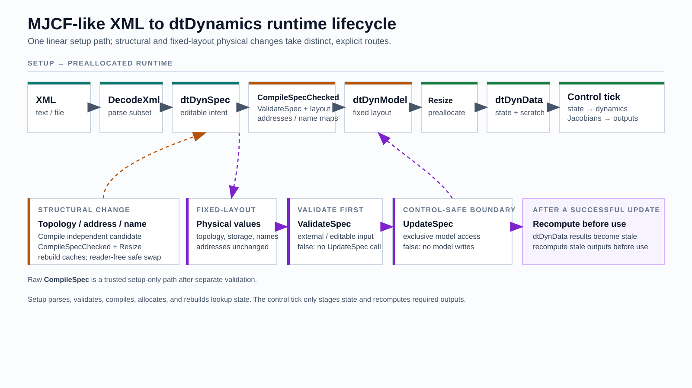
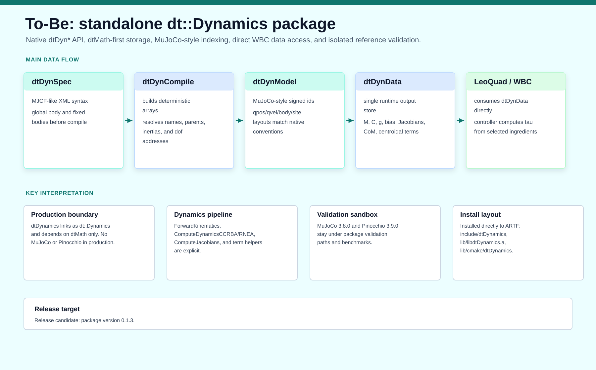
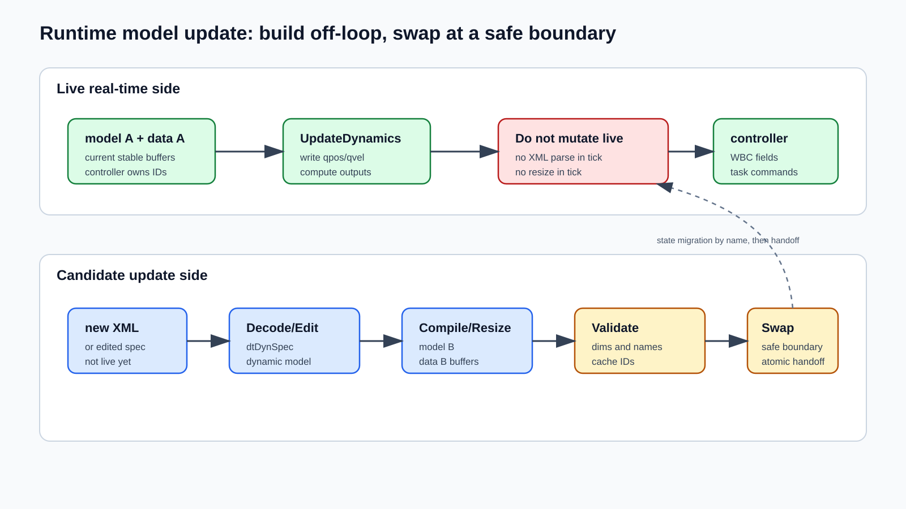

<!-- _class: cover -->

<div class="cover-purpose"><span><b>○</b>Decision Making</span><span><b>●</b>Information Sharing</span><span><b>○</b>Directions</span></div>

# MJCF XML, dtDynSpec, dtDynModel, and Runtime Updates

<div class="cover-meta">July 23, 2026<br/>LeoQuad Control &amp; Dynamics<br/>Source: <code>docs/guides/model_guide/mjcf-xml-dtdynspec-dtdynmodel-guide.md</code></div>

---

<!-- _class: agenda -->

# Today's flow

1. Architecture — the XML-to-runtime pipeline and its three layers
2. XML subset — what DecodeXml accepts, rejects, and ignores
3. Compilation — how CompileSpec fixes dimensions and addresses
4. LeoQuad runtime — per-tick state staging, dynamics, and exports
5. Runtime updates — safe structural reload and hot-swap patterns

---

<!-- _class: divider -->

# Part 1 — Architecture and layers

---

<span class="kicker">Architecture</span>

# The whole path

<div class="block-diagram block-diagram--flow-arrows">
  <div class="diagram-node"><h3>MJCF-like XML</h3><p>Robot description file. Import/export format only.</p></div>
  <div class="diagram-arrow">→</div>
  <div class="diagram-node"><h3>dtDynSpec</h3><p><code>DecodeXml</code> builds an editable model tree.</p></div>
  <div class="diagram-arrow">→</div>
  <div class="diagram-node"><h3>dtDynModel</h3><p><code>CompileSpec</code> freezes indices, dimensions, layout.</p></div>
  <div class="diagram-arrow">→</div>
  <div class="diagram-node"><h3>dtDynData</h3><p><code>Resize(model)</code> allocates runtime buffers once.</p></div>
</div>

<div class="svg-layer-arrow"><span>every control tick</span></div>

<div class="block-diagram block-diagram--arch">
  <div class="diagram-node diagram-node--accent"><h3>qpos/qvel update</h3><p><code>ComputeDynamicsCCRBA</code> + <code>ComputeJacobians</code></p></div>
  <div class="diagram-arrow">→</div>
  <div class="diagram-node diagram-node--accent"><h3>WBC fields</h3><p>Controller-facing poses, Jacobians, centroidal terms.</p></div>
</div>

---

<span class="kicker">Architecture</span>

# Why MJCF-like XML?

<div class="columns-2-1">
<div>

`dtDynamics` is **not** MuJoCo and is not a MuJoCo wrapper. It reuses useful model semantics:

- body tree rooted at `world`
- free, ball, slide, and hinge joints
- MuJoCo-compatible `qpos` and `qvel` sizes
- named body, joint, site, and actuator lookup
- MJCF-style robot description files
- external validation against MuJoCo and Pinocchio

</div>
<div class="callout sand">

## Boundary

Production code remains `dtMath`-only. The XML dialect is a file-format choice, not a runtime dependency.

</div>
</div>

---

<!-- _class: code-heavy -->

<span class="kicker">Architecture</span>

# LeoQuad package boundary

<div class="code-split">
<div>

LeoQuad links the installed native package:

```cmake
find_package(dtDynamics CONFIG REQUIRED)
target_link_libraries(dtcontrol PUBLIC dt::Dynamics)
```

</div>
<div class="callout">

## Important consequence

- `<mujoco>` can still be the XML root.
- It is only a file-format choice.
- The native package does not include MuJoCo headers.
- The native package does not link MuJoCo libraries.

</div>
</div>

---

<!-- _class: table-heavy -->

<span class="kicker">Architecture</span>

# Three runtime layers

| Layer | Mutable? | Purpose | Use it when... |
|---|---:|---|---|
| `dtDynSpec` | yes | editable model description | importing, editing, exporting XML |
| `dtDynModel` | no | compiled index/layout contract | control code needs stable IDs and dimensions |
| `dtDynData` | yes | runtime state, scratch, outputs | every control tick updates state and recomputes |

<div class="callout">

**Key design rule** — Spec changes require recompile. Model changes require data resize. State changes only require `qpos/qvel` update plus recompute.

</div>

---

<span class="kicker">Layer 1</span>

# dtDynSpec: editable tree

<div class="columns-2">
<div>

## Owns dynamic containers for

- bodies
- joints
- sites
- actuators
- inertial properties
- parent-child topology

</div>
<div>

## Operational details

- `Clear()` creates body `0` named `world`.
- `AddBody(name, parent)` appends a body.
- A body with no joints is fixed.
- Joints and sites attach to their owning body.
- `DecodeXml(xml)` imports the supported MJCF-like subset.
- `EncodeXml()` writes deterministic canonical XML.

</div>
</div>

---

<span class="kicker">Layer 2</span>

# dtDynModel: compiled contract

`dtDynModel` answers the questions control code cares about:

<div class="columns-2">
<div>

- how many generalized coordinates exist: `nq`
- how many velocities exist: `nv`
- where each joint starts in `qpos`
- where each joint starts in `qvel`
- which body owns each DOF

</div>
<div>

- which bodies are fixed
- which bodies are roots
- where names map to body, joint, site, and actuator IDs
- how large all `dtDynData` buffers must be

</div>
</div>

<div class="callout sand">

After compilation, controller code should treat it as **read-only**.

</div>

---

<span class="kicker">Layer 3</span>

# dtDynData: runtime state and output

`dtDynData::Resize(model)` allocates buffers for one model shape. It stores:

- input state: `qpos`, `qvel`
- body pose outputs: `xpos`, `xmat`, `xipos`
- site pose outputs: `site_xpos`, `site_xmat`
- Jacobians: body and site linear/angular terms plus dot terms
- dynamics: `Mmat`, `Cmat`, gravity, coriolis, nonlinear torque
- centroidal terms: `cmAmat`, `centMom`, `comPos`, `comVel`
- scratch arrays used by recursive dynamics algorithms

> Real-time ticks update **values**, not **shapes**.

---

<!-- _class: diagram -->

# Object lifetime diagram



---

<!-- _class: diagram -->

# To-Be standalone dtDynamics architecture

<span class="subtitle">Higher-level package view; not a literal diagram of the current LeoQuad export-copy path.</span>



---

<!-- _class: divider -->

# Part 2 — XML subset and decode

---

<!-- _class: dense table-heavy -->

<span class="kicker">XML subset</span>

# Supported XML subset

| XML item | Native behavior |
|---|---|
| `<mujoco>` | root syntax only |
| `<compiler angle="radian">` | no scaling |
| `<compiler angle="degree">` | range conversion to radians |
| other compiler angle units | throw an unsupported-angle error |
| XML comments | valid comments are skipped; malformed comments throw |
| `<worldbody>` | enables body-tree parsing |
| `<body name pos quat>` | creates `dtDynBodySpec` |
| `<inertial pos quat mass diaginertia>` | fills inertial spec |
| `<joint name type pos axis range limited armature>` | creates joint spec; missing/unknown `type` defaults to hinge |
| `<freejoint name>` | creates free joint |
| `<site name pos quat>` | creates task/sensor frame metadata |
| `<motor name joint gear>` | maps actuator to parsed joint |

---

<span class="kicker">XML subset</span>

# Rejected and ignored XML

<div class="columns-2">
<div class="callout caution">

## Explicitly rejected

| XML item | Behavior |
|---|---|
| `<equality>` | throws unsupported tree-only dynamics error |
| `<tendon>` | same rejection path |

</div>
<div>

## Ignored by native dynamics

- `<asset>`
- `<mesh>`
- `<geom>`
- `<option>`
- simulator rendering fields
- unknown non-rejected tags

</div>
</div>

Do **not** assume mesh, geom, or render-only edits change `dtDynModel`.

---

<span class="kicker">Decode</span>

# DecodeXml mental model

`dtDynSpec::DecodeXml(xml)` performs a single import into an editable spec.

1. Reject `<equality>` and `<tendon>`.
2. Create a fresh spec with `world` at body index `0`.
3. Track whether parsing is inside `<worldbody>` or `<actuator>`.
4. Track a body stack for nested body parentage.
5. Read `<compiler angle="...">` for range scaling.
6. Parse supported tags into spec containers.
7. Resolve motor actuators by joint name.
8. Return the editable `dtDynSpec`.

---

<!-- _class: code-heavy -->

<span class="kicker">Decode</span>

# Minimal decode example

<div class="code-split">
<div>

```xml
<mujoco model="single_arm">
  <compiler angle="radian"/>
  <worldbody>
    <body name="base" pos="0 0 0">
      <body name="link" pos="1 0 0">
        <inertial pos="0.5 0 0" mass="2.5"
                  diaginertia="0.1 0.2 0.3"/>
        <joint name="hinge_z" type="hinge"
               axis="0 0 1" armature="0.05"/>
        <site name="tool" pos="1 0 0"/>
      </body>
    </body>
  </worldbody>
  <actuator>
    <motor name="hinge_motor" joint="hinge_z" gear="80"/>
  </actuator>
</mujoco>
```

</div>
<div class="callout sand">

## Decoded structure

```text
world
 -> base   (fixed body)
 -> link   (hinge body)
 -> tool   (site)
hinge_motor -> hinge_z, gear=80
```

</div>
</div>

---

<!-- _class: code-heavy -->

<span class="kicker">Decode</span>

# LeoQuad XML subset

<div class="code-split">
<div>

In `model/LeoQuad_QD1.xml`:

```xml
<body name="BODY">
  <freejoint name="BODY" />
  <inertial pos="0.0056 0 0.0064"
            quat="0 0.707107 0 0.707107"
            mass="18.0916"
            diaginertia="0.5007 0.4487 0.0965"/>
  <body name="FL_HP" pos="...">
    <joint name="FL_HR_JOINT" type="hinge" .../>
    ...
    <site name="FL_FOOT" pos="0 0 -0.3244"/>
  </body>
</body>
```

</div>
<div>

## For dtDynamics

- `BODY` is the physical root body under `world`.
- `<freejoint>` gives `BODY` 7 `qpos` and 6 `qvel` entries.
- hip, thigh, and calf joints add one `qpos` and one `qvel` each.
- foot sites become named task frames owned by their nested leg bodies.
- mesh and geom tags are ignored by native dynamics.

</div>
</div>

---

<span class="kicker">Encode</span>

# EncodeXml role

`dtDynSpec::EncodeXml()` writes deterministic XML for the supported subset.

<div class="columns-2">
<div>

## It emits

- `<mujoco>` root
- `<compiler angle="radian"/>`
- recursive `<worldbody>` body tree
- body `name`, `pos`, and `quat`
- inertial data when `mass != 0`

</div>
<div>

&nbsp;

- all joints as `<joint ... type="...">`; decoded `<freejoint>` becomes `type="free"`
- sites with pose attributes
- actuator motors if actuator specs exist
- floating-point values at high precision

</div>
</div>

<div class="callout sand">

Use it as a **native model-spec exporter**, not as a full MuJoCo scene exporter.

Round-trip check: `DecodeXml → EncodeXml → DecodeXml` should preserve body, joint, site, and actuator counts.

</div>

---

<!-- _class: divider -->

# Part 3 — Compilation and layout

---

<!-- _class: compact -->

<span class="kicker">Compile</span>

# CompileSpec purpose

`CompileSpec(spec, model)` freezes editable model information into fixed arrays.

Compilation assigns:

- dimensions: `nq`, `nv`, `nbody`, `njnt`, `nsite`, `nu`, `nroot`
- body arrays: parent, joint/DOF address, `root_bodyid`, `root_mass`, `body_rootid`, `body_rootidx`
- joint arrays: type, `qpos` address, `qvel` address
- DOF arrays: body owner, parent DOF, joint owner, armature
- `site_bodyid`, `actuator_jointid`, and `actuator_gear`
- lookup maps for bodies, joints, and sites

<div class="callout">

This is the transition from **descriptive structure** to **runtime contract**.

```cpp
dtDynModel model;
CompileSpec(spec, model);
dtDynData data;
data.Resize(model);
assert(data.IsCompatible(model));
```

</div>

---

<!-- _class: code-heavy -->

<span class="kicker">Compile</span>

# Joint sizes

<div class="code-split">
<div>

`dtDynamics` follows MuJoCo-compatible sizes.

| Joint type | Enum | `qpos` | `qvel` |
|---|---:|---:|---:|
| Free | 0 | 7 | 6 |
| Ball | 1 | 4 | 3 |
| Slide | 2 | 1 | 1 |
| Hinge | 3 | 1 | 1 |

</div>
<div>

## LeoQuad layout

```text
qpos = [base position_G(3),
        base quaternion_GB(4),
        12 joint positions]
     = 19 values

qvel = [base linear velocity_G(3),
        base angular velocity_B(3),
        12 joint velocities]
     = 18 values
```

</div>
</div>

---

<!-- _class: code-heavy -->

<span class="kicker">Compile</span>

# LeoQuad dimension guard

LeoQuad checks the compiled model before using it:

```cpp
if (model.dynModel.nq != DOF_TOTAL_QUAT || model.dynModel.nv != DOF_TOTAL) {
    throw std::runtime_error(
        "Robot::InitializeDynamicsModel model dimensions do not match LeoQuad qpos/qvel constants");
}
```

<div class="callout caution">

## Why this matters

- XML structure controls `nq` and `nv`.
- Controller constants assume one floating base plus 12 actuated joints.
- Any structural model update must preserve that contract or intentionally update the controller side too.

</div>

---

<!-- _class: code-heavy -->

<span class="kicker">Compile</span>

# qpos/qvel addresses

<div class="code-split">
<div>

For a free base plus one hinge:

```text
joint 0: floating_base
  qpos adr = 0    qpos size = 7
  qvel adr = 0    qvel size = 6

joint 1: hip_pitch
  qpos adr = 7    qpos size = 1
  qvel adr = 6    qvel size = 1
```

</div>
<div class="callout sand">

## First hinge after a free base

```cpp
data.qpos(7) = hipPosition;
data.qvel(6) = hipVelocity;
```

</div>
</div>

---

<span class="kicker">Topology</span>

# World, fixed bodies, and roots

<div class="comparison">
<div>

### World body

- body ID `0`
- not physical mass
- no joint and no DOF
- topology parent for physical roots
- not a dynamics-recursion participant

</div>
<div>

### Fixed body

- any non-world body with no joint
- can have mass, inertia, sites, and child bodies
- contributes to composite inertia
- does not create `qpos` or `qvel` columns

</div>
</div>

<div class="callout sand">

Root metadata identifies each physical root and its mass. For multi-root models, `cmAmat` is `6*nroot × nv` and `comJmat` is `3*nroot × nv`.

</div>

---

<!-- _class: divider -->

# Part 4 — LeoQuad runtime loop

---

<!-- _class: code-heavy -->

<span class="kicker">Initialization</span>

# LeoQuad initialization path

<div class="code-split">
<div>

`Robot::InitializeDynamicsModel(model, data, fileName)` does:

```cpp
const dtDynSpec spec =
    dtDynSpec::DecodeXml(ReadTextFile(fileName));
dtDyn::CompileSpec(spec, model.dynModel);
data.dynData.Resize(model.dynModel);
```

</div>
<div>

## Then it validates and caches IDs

- required body names resolve through `BodyId(...)`
- required task names resolve through `SiteId(...)`
- task body IDs are derived from `site_bodyid`
- Jacobian body IDs include the root/base body
- Jacobian site IDs include all task sites

Cached IDs prevent repeated name lookup in the control loop.

</div>
</div>

---

<!-- _class: code-heavy -->

<span class="kicker">Per tick</span>

# Per-cycle state staging

Every `Robot::UpdateDynamics` writes the current state:

```cpp
// qpos: base position in world.
data.dynData.qpos(0) = data.actControlState.basePosG_G(0);
data.dynData.qpos(1) = data.actControlState.basePosG_G(1);
data.dynData.qpos(2) = data.actControlState.basePosG_G(2);

// qpos: base quaternion.
for (SYSINDEX i = 0; i < DOF4; ++i) {
    data.dynData.qpos(DOF3 + i) = data.base.quat(i);
}

// qpos/qvel: joints after floating base.
for (SYSINDEX i = 0; i < NUM_JOINT; ++i) {
    data.dynData.qpos(DOF7 + i) = data.actJointData.pos_rad(i);
    data.dynData.qvel(DOF6 + i) = data.actJointData.vel_rps(i);
}
```

---

<!-- _class: code-heavy -->

<span class="kicker">Per tick</span>

# Velocity convention

<div class="code-split">
<div>

LeoQuad uses one fixed convention:

```text
qvel = [base linear velocity_G,
        base angular velocity_B,
        joint velocity]
```

There is **no public coordinate-type selector**.

</div>
<div>

The base fields are staged as:

```cpp
// base linear velocity in global frame
data.dynData.qvel(0) = data.actControlState.baseLinVelB_G(0);
data.dynData.qvel(1) = data.actControlState.baseLinVelB_G(1);
data.dynData.qvel(2) = data.actControlState.baseLinVelB_G(2);

// base angular velocity in base/body frame
for (SYSINDEX i = 0; i < DOF3; ++i) {
    data.dynData.qvel(DOF3 + i) = data.base.angVel_B(i);
}
```

</div>
</div>

---

<!-- _class: code-heavy -->

<span class="kicker">Per tick</span>

# Dynamics and Jacobians per tick

LeoQuad computes a reduced WBC term set:

```cpp
constexpr dtDyn::dtDynCcrbaTermFlags dynamicsTerms =
    dtDyn::DTDYN_CCRBA_TERM_COM_POS |
    dtDyn::DTDYN_CCRBA_TERM_CMAMAT |
    dtDyn::DTDYN_CCRBA_TERM_CENT_MOM;

dtDyn::ComputeDynamicsCCRBA(model.dynModel, data.dynData, gravity, dynamicsTerms);

dtDyn::ComputeJacobians(model.dynModel,
                        data.dynData,
                        model.dynJacobianBodyIds,
                        model.dynJacobianSiteIds);
```

<div class="callout sand">

Separation is intentional: dynamics terms and selected body/site Jacobians are computed through **separate APIs**. Indexed lists avoid computing every body and site Jacobian.

</div>

---

<!-- _class: table-heavy -->

<span class="kicker">Per tick</span>

# Controller-facing exports

| Native field | Controller-facing use |
|---|---|
| `xpos[bodyId]` | body position |
| `xipos[bodyId]` | body CoM position |
| `xmat[bodyId]` | body orientation |
| `site_xpos[siteId]` | foot/task position |
| `site_xmat[siteId]` | foot/task orientation |
| `site_jacp[siteId]` | linear task Jacobian |
| `site_jacr[siteId]` | angular task Jacobian |
| `site_jacp_dot[siteId]` | linear task Jacobian derivative |
| `site_jacr_dot[siteId]` | angular task Jacobian derivative |
| `body_jacp[baseBodyId]` | base linear Jacobian |
| `body_jacr[baseBodyId]` | base angular Jacobian |
| `centMom`, `cmAmat`, `comPos` | centroidal and CoM fields |

---

<!-- _class: divider -->

# Part 5 — Runtime model updates

---

<span class="kicker">Runtime updates</span>

# Runtime update has two meanings

<div class="comparison">
<div>

### State-only update

```text
same model, same buffers
  -> update qpos/qvel
  -> recompute dynamics
  -> recompute selected Jacobians
  -> export outputs
```

</div>
<div>

### Structural or parameter update

- body mass or inertia change
- add/remove site, body, or joint
- change joint type
- change actuator metadata
- load another XML model

Requires a **new spec, new model, and compatible data buffers**.

</div>
</div>

---

<span class="kicker">Runtime updates</span>

# Safe model update rule

<div class="callout caution">

Do **not** mutate the live `dtDynModel` while the control loop is reading it. Build a candidate model/data pair off the real-time path. Validate it. Swap it only at a safe boundary.

</div>

A candidate model must pass:

- controller dimension checks: `nq`, `nv`
- required body name lookup
- required site name lookup
- `data.IsCompatible(model)` after resize
- rebuilt body/site/Jacobian caches
- no allocation or XML parsing inside the real-time tick

---

<!-- _class: diagram -->

# Runtime model update diagram



---

<!-- _class: code-heavy -->

<span class="kicker">Runtime updates</span>

# Hot-swap container pattern

<span class="subtitle">Proposed pattern — not current LeoQuad production code.</span>

<div class="code-split">
<div>

```cpp
struct DynamicsRuntime
{
    dtDyn::dtDynModel model;
    dtDyn::dtDynData data;
    dtDyn::dtDynArray<dtDyn::dtDynIndex> jacBodyIds;
    dtDyn::dtDynArray<dtDyn::dtDynIndex> jacSiteIds;
};

DynamicsRuntime BuildRuntimeFromXml(const std::string &xml)
{
    DynamicsRuntime next;
    const dtDyn::dtDynSpec spec = dtDyn::dtDynSpec::DecodeXml(xml);
    dtDyn::CompileSpec(spec, next.model);
    next.data.Resize(next.model);
    if (!next.data.IsCompatible(next.model))
        throw std::runtime_error("candidate model/data mismatch");
    return next;
}
```

</div>
<div class="callout">

## Rule

A safe reload builds an **independent candidate** first.

Then validate the LeoQuad contract before any live swap.

</div>
</div>

---

<span class="kicker">Runtime updates</span>

# Preserve state by name

When reloading a model with the same named joints:

- map old joint name to new joint ID
- require the same joint type
- copy `qpos` by each joint's `jnt_qposadr`
- copy `qvel` by each joint's `jnt_dofadr`
- skip missing or type-changed joints

<div class="callout caution">

Do **not** assume joint order is unchanged. If a new free joint appears and state is not copied, initialize the quaternion to identity before computing dynamics.

</div>

---

<!-- _class: dense code-heavy -->

<span class="kicker">Runtime updates</span>

# Live swap at a safe boundary

<div class="code-split">
<div>

Build and queue the candidate outside the control tick:

```cpp
void RequestModelReload(const std::string &xml)
{
    DynamicsRuntime next = BuildRuntimeFromXml(xml);
    ValidateLeoQuadContract(next.model);
    std::lock_guard<std::mutex> lock(pendingMutex);
    pendingRuntime = std::move(next);
    pendingSwap = true;
}
```

</div>
<div>

Migrate state and swap only at the control-thread boundary:

```cpp
std::lock_guard<std::mutex> lock(pendingMutex);
if (pendingSwap) {
    CopyJointStateByName(model.dynModel, data.dynData,
                         pendingRuntime.model, pendingRuntime.data);
    model.dynModel = std::move(pendingRuntime.model);
    data.dynData = std::move(pendingRuntime.data);
    RebuildLeoQuadCaches(model, data);
    pendingSwap = false;
}
```

</div>
</div>

<div class="callout caution">

For hard real-time code, replace `std::mutex` and heap-owning moves with the process's real-time-safe handoff mechanism. Parse, compile, validate, and allocate outside the tick.

</div>

---

<!-- _class: code-heavy -->

<span class="kicker">Runtime updates</span>

# Edit mass and recompile

`FindBodyInSpecByName` is a local helper, not a public `dtDynSpec` API; implement it by scanning `spec.Bodies()`.

For a model edit:

```cpp
dtDyn::dtDynSpec spec = dtDyn::dtDynSpec::DecodeXml(ReadTextFile("model/LeoQuad_QD1.xml"));

const dtDyn::dtDynIndex body = FindBodyInSpecByName(spec, "BODY");
spec.Bodies()[body].inertial.mass += 0.25;

dtDyn::dtDynModel updatedModel;
dtDyn::CompileSpec(spec, updatedModel);

dtDyn::dtDynData updatedData;
updatedData.Resize(updatedModel);
```

<div class="callout sand">

Every spec edit requires `CompileSpec` and `Resize`; verify `updatedData.IsCompatible(updatedModel)` before publishing the candidate.

</div>

---

<!-- _class: dense code-heavy -->

<span class="kicker">Runtime updates</span>

# Other spec edits: construct bodies and add sites

<div class="code-split">
<div>

Create topology programmatically:

```cpp
dtDyn::dtDynSpec spec;
const auto trunk = spec.AddBody("trunk", 0);
spec.AddJoint(trunk, "floating_base", dtDyn::dtDynJointType::Free);

const auto thigh = spec.AddBody("front_left_thigh", trunk);
const auto hip = spec.AddJoint(
    thigh, "front_left_hip", dtDyn::dtDynJointType::Hinge);
spec.Joints()[hip].axis(1) = 1.0;
```

</div>
<div>

Add an inspection site, then recompile:

```cpp
const auto site = spec.AddSite(thigh, "BODY_DEBUG_SITE");
spec.Sites()[site].pos(2) = 0.2;

dtDyn::dtDynModel model = dtDyn::CompileSpec(spec);
dtDyn::dtDynData data;
data.Resize(model);
const auto siteId = model.SiteId("BODY_DEBUG_SITE");
dtDyn::ComputeSiteJacobian(model, data, siteId, jacp, jacr);
```

</div>
</div>

<div class="callout sand">

Adding a site changes `nsite` but not `nq` or `nv`; it still requires compile and resize because site cache arrays change.

</div>

---

<!-- _class: dense table-heavy -->

<span class="kicker">Pitfalls</span>

# Common mistakes

| Mistake | Correct approach |
|---|---|
| Reparse XML every control tick | Parse/compile once, update `qpos/qvel` each tick |
| Edit `dtDynModel` arrays directly | Edit `dtDynSpec`, compile, resize data |
| Keep old cached IDs after reload | Rebuild caches from names |
| Assume `<geom>` or `<mesh>` affects dynamics | Use `<inertial>`, `<joint>`, `<body>`, `<site>` |
| Treat body `0` as physical | Body `0` is world |
| Treat no-joint bodies as nonphysical | No-joint bodies can be fixed physical bodies |
| Compute sites only when the base Jacobian is needed | Pass the base body ID and site IDs to indexed `ComputeJacobians` |
| Skip `data.Resize(model)` after a structural edit | Resize, then verify `data.IsCompatible(model)` |
| Swap while dynamics reads model | Build off-loop, swap at a safe boundary |

---

<!-- _class: code-heavy -->

<span class="kicker">Validation</span>

# Validation checklist

<div class="code-split">
<div>

Documentation-only review:

```bash
git status --short docs/dtdynamics
```

Runtime/model code changes:

```bash
cmake --build build --target simRobot
tools/validate_simrobot_trot.sh --smoke
tools/validate_simrobot_trot.sh --headless-trot
SIMROBOT_PROFILE_DYNAMICS=1 \
  tools/validate_simrobot_trot.sh --headless-trot
SIMROBOT_PROFILE_DYNAMICS=1 \
  tools/validate_external_dtdynamics_package.sh
```

</div>
<div class="callout">

## Model update review

- XML decodes without equality/tendon rejection.
- `nq` and `nv` match controller expectations.
- required body and task site names resolve.
- cached Jacobian body/site ID lists are rebuilt.
- `data.IsCompatible(model)` is true after resize.
- the real-time loop does not allocate or parse XML.

</div>
</div>

---

<span class="kicker">Summary</span>

# One-slide team explanation

1. XML is an import/export format, not the runtime model.
2. `DecodeXml` reads the supported MJCF-like subset into `dtDynSpec`, which is editable and dynamic.
3. `CompileSpec` freezes it into `dtDynModel` arrays with stable body, joint, `qpos`, `qvel`, DOF, site, and root indices.
4. `dtDynData` is resized once and reused; each tick updates `qpos/qvel` and recomputes dynamics/Jacobians.
5. Structural updates are built off-loop, validated, recached, and swapped at a safe boundary.

<div class="callout">

**Rule of thumb** — Spec changes recompile, model changes resize, state changes only recompute.

</div>

---

<!-- _class: closing -->

# Thank you

<p class="subtitle">LeoQuad Control &amp; Dynamics · dtDynamics briefing</p>
