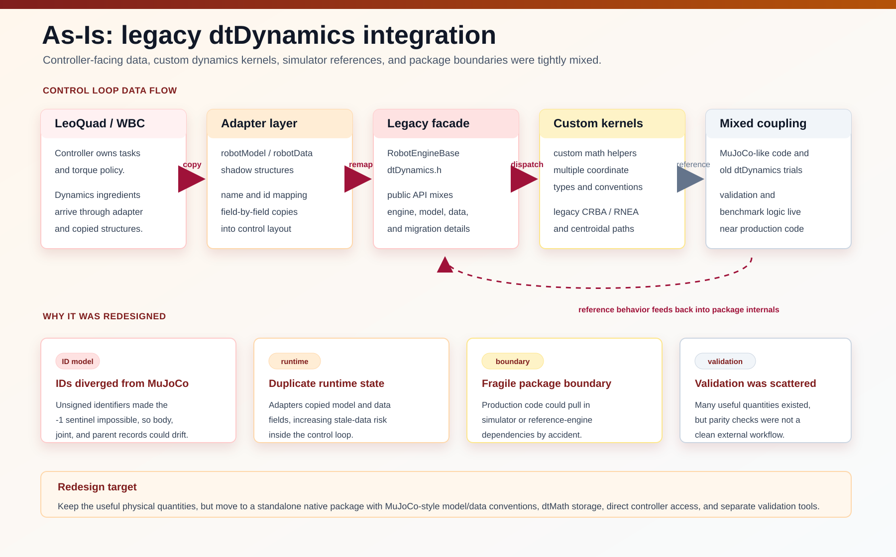

<!-- _class: cover -->

<div class="cover-purpose"><span><b>○</b>Decision Making</span><span><b>●</b>Information Sharing</span><span><b>○</b>Directions</span></div>

# dtDynamics 0.1.3 사용과 Legacy Migration

<div class="cover-meta">2026년 10월 1일<br/>Joonhee Jo<br/>Checked setup · Native API · 설치 경계</div>

---

<!-- _class: agenda -->

# 오늘의 흐름

1. 현재 package 경계 — dynamics ingredient engine
2. 내부 algorithm — MuJoCo-style baseline과 CCRBA
3. 안전한 사용 — load, validate, checked compile, resize, cache, run
4. Migration — legacy engine에서 native API로
5. Validation과 성능 — independent reference와 runtime evidence

---

<!-- _class: divider -->

# Part 1 — What dtDynamics is now

---

<span class="kicker">Scope</span>

# An ingredient engine, not a simulator

<div class="columns-2-1">
<div>

`dtDynamics` computes the kinematic, dynamic, centroidal, and derivative quantities that WBC, state estimation, and planners consume.

- deterministic memory ownership after initialization
- one fixed, documented coordinate convention
- `dtMath` as the **only** math dependency
- MuJoCo-compatible indexing and XML-oriented model semantics
- controller-ready quantities general simulators do not expose

</div>
<div class="callout caution">

## Not in scope

- contact solving
- forward simulation integrators
- **final torque command** — controllers own torque
- closed chains before the equality layer exists

</div>
</div>

---

<!-- _class: diagram -->

# As-Is: legacy integration path



---

<!-- _class: diagram -->

# To-Be: standalone native package


---

<!-- _class: code-heavy -->

<span class="kicker">Boundary</span>

# CMake package boundary

<div class="code-split">
<div>

Production consumers link the installed package target:

```cmake
find_package(dtDynamics 0.1.3 EXACT CONFIG REQUIRED)
target_link_libraries(my_controller PRIVATE dt::Dynamics)
```

- production target is **dtMath-only**
- MuJoCo / Pinocchio are linked only by dedicated validation and benchmark executables
- LeoQuad prepends `DTDYNAMICS_INSTALL_PREFIX` to `CMAKE_PREFIX_PATH`

</div>
<div class="callout caution">

## Include-order rule

If a project also includes a shared ART Framework include directory, the installed `dtDynamics` include path must come **before** any older `ART_Framework/include/dtDynamics` copy.

Mixing a new `libdtDynamics.a` with stale headers changes object layout and can corrupt `dtDynModel`/`dtDynData` arrays at runtime.

</div>
</div>

---

<!-- _class: divider -->

# Part 2 — Algorithms inside

---

<span class="kicker">Algorithms</span>

# MuJoCo-style smooth-dynamics baseline

Native `dtMath` reimplementation of the MuJoCo 3.8.0 stage structure:

<div class="columns-2">
<div>

1. body kinematics — `mj_kinematics`
2. inertial-frame / subtree-CoM mapping — `mj_comPos`
3. mass matrix: CRBA then armature — `mj_makeM` / `mj_crb`
4. optional factorization — `mj_factorM`

</div>
<div>

5. CoM-frame velocity, motion-subspace derivatives — `mj_comVel`
6. RNEA bias forces — `mj_rne` (gravity, coriolis, nonlinear)
7. body/site Jacobians — `mj_jac*`
8. Jacobian time variation — `mj_jacDot`

</div>
</div>

<div class="callout sand">

MuJoCo names are **structural references only** — the package neither includes nor links MuJoCo.

</div>

---

<span class="kicker">Algorithms</span>

# CCRBA: the dtDynamics-specific layer

Control-oriented Composite Rigid Body Algorithm — adds what MuJoCo does not expose in controller form:

<div class="columns-2">
<div>

- controller-compatible `Cmat` where `coriolisTorq = Cmat * qvel`
- CMM `cmAmat` and derivative `cmAmatDot`
- CoM Jacobian `comJmat` and `comJmatDot`
- centroidal momentum `centMom`
- `MmatDot` for derivative-aware control

</div>
<div class="callout">

## One-pass design

`coriolisTorq` is accumulated **while `Cmat` is filled** — no second dense `Cmat * qvel` pass.

Gravity, Coriolis, and nonlinear torques come from the CCRBA pass itself instead of a separate RNEA call.

</div>
</div>

---

<!-- _class: code-heavy -->

<span class="kicker">Algorithms</span>

# Two explicit entry points, no generic alias

<div class="comparison">
<div>

### ComputeDynamicsRNEA

Lighter path: MuJoCo-step-like base ingredients only.

```cpp
// Mmat, gravityTorq, coriolisTorq, nonlinTorq
ComputeDynamicsRNEA(model, data, gravity,
                    DTDYN_RNEA_TERM_COM_POS);
```

Optional flags: `DTDYN_RNEA_TERM_COM_POS` only.

</div>
<div>

### ComputeDynamicsCCRBA

Base ingredients plus `Cmat`, plus opt-in centroidal terms.

```cpp
ComputeDynamicsCCRBA(model, data, gravity,
    DTDYN_CCRBA_TERM_COM_POS |
    DTDYN_CCRBA_TERM_CMAMAT  |
    DTDYN_CCRBA_TERM_CENT_MOM);
```

Flags: `CMAMAT`, `CMAMAT_DOT`, `COM_JMAT`, `COM_JMAT_DOT`, `CENT_MOM`, `COM_VEL`, `MMAT_DOT`.

</div>
</div>

<div class="callout sand">

Neither call computes body/site Jacobians — request them separately with `ComputeJacobians`.

</div>

---

<span class="kicker">Algorithms</span>

# World-body and fixed-body safety rules

The recursion is hardened against the classic CCRBA failure mode: treating world body `0` as a physical body corrupts centroidal terms.

<div class="columns-2">
<div>

## World body `0`

- work buffers explicitly zeroed
- physical body loops start at index `1`
- backward accumulation stops before `0`
- never owns DOF, mass, or inertia

</div>
<div>

## Fixed body (no joint)

- physical: mass, inertia, sites, children
- contributes through parent composite inertia
- creates **no** columns in `M`, `C`, Jacobians, CMM
- body-indexed arrays sized by `nbody`, DOF-indexed by `nv`

</div>
</div>

Multi-root models: centroidal outputs are stacked **per root** (`6*nroot` rows), driven by `body_rootid` metadata.

---

<!-- _class: divider -->

# Part 3 — How to use dtDynamics

---

<!-- _class: code-heavy -->

<span class="kicker">Usage</span>

# Build a model from XML

```cpp
#include <dtDynamics/dtDynCompile.h>
#include <dtDynamics/dtDynData.h>
#include <dtDynamics/dtDynSpec.h>

using namespace dt::Dynamics;

const dtDynSpec spec =
    dtDynSpec::LoadXmlFile(
        "model/LeoQuad_QD1.xml");

// Optional normalized native-spec export.
spec.SaveXmlFile(
    "model/LeoQuad_QD1.native.xml");

const dtDynModel model =
    CompileSpecChecked(spec);
dtDynData data;
data.Resize(model);
```

---

<!-- _class: code-heavy -->

<span class="kicker">Usage</span>

# Build a programmatic spec

```cpp
dtDynSpec spec;
const dtDynIndex base =
    spec.AddBody("base", 0);
spec.AddJoint(
    base, "floating_base",
    dtDynJointType::Free);

const dtDynIndex link =
    spec.AddBody("link", base);
spec.EditBody(link, [](dtDynBodySpec &draft)
              {
                  draft.pos(0) = 0.35;
                  draft.inertial.mass = 1.0;
              });

const dtDynIndex hip = spec.AddJoint(
    link, "hip_pitch",
    dtDynJointType::Hinge);
spec.EditJoint(hip, [](dtDynJointSpec &draft)
               {
                   draft.axis.SetZero();
                   draft.axis(1) = 1.0;
               });
const dtDynIndex foot =
    spec.AddSite(link, "foot");
spec.EditSite(foot, [](dtDynSiteSpec &draft)
              { draft.pos(2) = -0.25; });
```

Compile editable/external specs through `CompileSpecChecked`; reserve raw `CompileSpec` for separately validated trusted setup data.

---

<!-- _class: code-heavy -->

<span class="kicker">Usage</span>

# Set state and compute

<div class="code-split">
<div>

```cpp
// qpos: base pos, quaternion w x y z, joints
data.qpos(2) = 0.5;
data.qpos(3) = 1.0;   // quaternion w
data.qpos(7) = 0.2;   // first hinge

// qvel: baseLinVel_G, baseAngVel_B, joints
data.qvel.SetZero();
data.qvel(0) = 0.1;
data.qvel(4) = 0.2;
data.qvel(6) = 0.3;

dt::Math::Vector3<dtDynReal> gravity;
gravity(2) = -9.81;
```

</div>
<div>

```cpp
ForwardKinematics(model, data);

constexpr dtDynCcrbaTermFlags wbcTerms =
    DTDYN_CCRBA_TERM_COM_POS |
    DTDYN_CCRBA_TERM_CMAMAT |
    DTDYN_CCRBA_TERM_CENT_MOM;

ComputeDynamicsCCRBA(model, data, gravity, wbcTerms);
```

Request only the optional terms the controller needs — heavier centroidal outputs cost time every tick.

</div>
</div>

---

<!-- _class: code-heavy -->

<span class="kicker">Usage</span>

# Jacobians: indexed for realtime, terms for one-offs

<div class="code-split">
<div>

Realtime loop — cache IDs once, pass them every tick:

```cpp
dtDynArray<dtDynIndex> bodyIds;
dtDynArray<dtDynIndex> siteIds;
const auto footSite = model.SiteId("foot");
if (footSite == DTDYN_INVALID_INDEX)
    throw std::runtime_error("required foot site missing");
bodyIds.push_back(model.root_bodyid[0]);
siteIds.push_back(footSite);

ComputeJacobians(model, data, bodyIds, siteIds);
```

Include the root/base body when the controller consumes a base Jacobian — site-only is not the LeoQuad contract.

</div>
<div>

One-off task point — `J`, `Jdot`, `Jdot*qvel` in one call. Reuse the checked `footSite` cached during setup:

```cpp
ComputeSiteJacobianTerms(model, data,
                         footSite,
                         &jacp, &jacr,
                         &jacpDot, &jacrDot,
                         &linJdotQvel,
                         &angJdotQvel);
```

Pass `nullptr` for outputs you do not need; shared column terms are computed once.

</div>
</div>

---

<!-- _class: dense table-heavy -->

<span class="kicker">Usage</span>

# Output quantity reference (core set)

| Field | Shape | Prerequisite | Controller use |
|---|---:|---|---|
| `xpos`, `xmat`, `xipos` | per body | `ForwardKinematics` or dynamics call | body pose / CoM export |
| `site_xpos`, `site_xmat` | per site | `ForwardKinematics` or dynamics call | task pose export |
| `Mmat` | `nv x nv` | RNEA or CCRBA | WBC inertia matrix |
| `Cmat` | `nv x nv` | CCRBA | explicit Coriolis matrix |
| `gravityTorq`, `coriolisTorq`, `nonlinTorq` | `nv` | RNEA or CCRBA | bias-force ingredients |
| `body_jacp/r`, `site_jacp/r` (+`_dot`) | `3 x nv` | `ComputeJacobians` / `*Terms` | task constraints, `Jdot*qvel` |
| `cmAmat`, `cmAmatDot` | `6*nr x nv` | CCRBA + `CMAMAT(_DOT)` | centroidal momentum control |
| `centMom` | `6*nr` | CCRBA + `CENT_MOM` | momentum feedback |
| `comPos`, `comVel`, `comJmat(Dot)` | `3*nr` rows | CCRBA + `COM_*` flags | CoM tracking |
| `MmatDot` | `nv x nv` | CCRBA + `MMAT_DOT` | derivative-aware control |

`nr = max(nroot, 1)`; centroidal blocks are stacked per root, rows ordered `[linear; angular]`.

---

<!-- _class: code-heavy -->

<span class="kicker">Usage</span>

# The LeoQuad realtime sequence

This is the migrated production pattern in `Robot::UpdateDynamics`:

```cpp
// 1. stage state (qpos/qvel convention: basePos_G, quat, baseLinVel_G, baseAngVel_B, joints)
data.dynData.qpos(...) = ...;
data.dynData.qvel(...) = ...;

// 2. reduced CCRBA — only the WBC terms
constexpr dt::Dynamics::dtDynCcrbaTermFlags dynamicsTerms =
    dt::Dynamics::DTDYN_CCRBA_TERM_COM_POS |
    dt::Dynamics::DTDYN_CCRBA_TERM_CMAMAT |
    dt::Dynamics::DTDYN_CCRBA_TERM_CENT_MOM;
dt::Dynamics::ComputeDynamicsCCRBA(model.dynModel, data.dynData, gravity, dynamicsTerms);

// 3. indexed Jacobians — base body + task sites cached at init
dt::Dynamics::ComputeJacobians(model.dynModel, data.dynData,
                        model.dynJacobianBodyIds, model.dynJacobianSiteIds);

// 4. export: read dtDynData fields directly into controller-facing terms
```

No XML parsing or name lookup inside the tick. On the documented pre-sized benchmark path, the C++ `new` counter reports zero calls; this is not a whole-process heap guarantee.

---

<!-- _class: divider -->

# Part 4 — Migrating from legacy dtDynamics

---

<!-- _class: table-heavy -->

<span class="kicker">Migration</span>

# Legacy vs redesigned, at a glance

| Aspect | Legacy (`leoquad-control_legacy`) | Redesigned (current) |
|---|---|---|
| Engine type | `RobotEngineBase<DOF_TOTAL, NUM_BODY, NUM_JOINT, COORD, T>` template | `dt::Dynamics` namespace API, runtime-sized |
| Model loading | `mj_loadXML` + `mj_makeData` — **MuJoCo in production** | `LoadXmlFile` / `DecodeXml` → `CompileSpecChecked` → `Resize` — dtMath-only |
| Sizes | compile-time template parameters | compiled `dtDynModel` dimensions (`nq`, `nv`, ...) |
| Body indices | manual re-basing: `bodyId[i] - startBodyId` | MuJoCo-compatible IDs + `BodyId`/`SiteId` lookup |
| Velocity basis | `COORDINATE_TYPE` selector 0/1/2 | one convention: `[linVel_G, angVel_B, qdot]` |
| Outputs | `Get*` calls copy into `RobotData` shadow fields | read `dtDynData` fields directly |
| Jacobians | per-body `GetBodyJacob` inside update loop | one indexed `ComputeJacobians` call |

---

<!-- _class: code-heavy -->

<span class="kicker">Migration</span>

# Step 1 — Model loading

<div class="comparison">
<div>

### Legacy

```cpp
// robot.h
dtDyn::RobotEngineBase<DOF_TOTAL, NUM_BODY,
    NUM_JOINT, 0, SYSREAL> physicsEngine;

// InitModel: MuJoCo loads the model in production
reVar.m_modelMUJOCO =
    mj_loadXML(modelFile, nullptr, error, 1000);
reVar.m_dataMUJOCO =
    mj_makeData(reVar.m_modelMUJOCO);

startBodyId = mj_name2id(m, mjOBJ_BODY,
                         robotBodyNames[0].c_str());
model.bodyId[i] = bodyId[i] - startBodyId;
```

</div>
<div>

### Redesigned

```cpp
// robotModel.h / robotData.h
dt::Dynamics::dtDynModel dynModel;
dt::Dynamics::dtDynData dynData;

// InitializeDynamicsModel: native decode/compile
const dtDynSpec spec =
    dtDynSpec::LoadXmlFile(fileName);
model.dynModel = dt::Dynamics::CompileSpecChecked(spec);
data.dynData.Resize(model.dynModel);

if (model.dynModel.nq != DOF_TOTAL_QUAT ||
    model.dynModel.nv != DOF_TOTAL)
    throw std::runtime_error("dimension mismatch");
```

</div>
</div>

---

<!-- _class: code-heavy -->

<span class="kicker">Migration</span>

# Step 2 — Cache IDs by name, once

<div class="comparison">
<div>

### Legacy

Local body numbering, re-derived from MuJoCo each init:

```cpp
data.actTaskStates[t].id =
    m->site_bodyid[mj_name2id(m, mjOBJ_SITE,
                              taskName)]
    - startBodyId;
```

Controllers then indexed everything with the shifted local IDs.

</div>
<div>

### Redesigned

Stable name lookup on the compiled model:

```cpp
const auto siteId = model.dynModel.SiteId(
    robotTaskNames[t]);
if (siteId == dt::Dynamics::DTDYN_INVALID_INDEX) {
    throw std::runtime_error("required task missing");
}
model.dynTaskSiteIds[t] = siteId;
model.dynTaskBodyIds[t] =
    model.dynModel.site_bodyid[siteId];

model.dynJacobianBodyIds.push_back(
    model.dynBodyIds[0]);
model.dynJacobianSiteIds.push_back(siteId);
```

Validate every ID at init; never look up names in the tick.

</div>
</div>

---

<!-- _class: code-heavy -->

<span class="kicker">Migration</span>

# Step 3 — Per-tick update

<div class="comparison">
<div>

### Legacy

```cpp
physicsEngine.ComputeKinematics(model, data);
physicsEngine.ComputeDynamics(model, data);

physicsEngine.GetBase2SubtreeCom(model, data,
    model.bodyId[0], comPosB_G);
physicsEngine.GetComVel(model, data, data.comVel);

for (i = 0; i < NUM_TASK; i++) {
    physicsEngine.GetBase2BodyPose(...);
    physicsEngine.GetBodyJacob(...);
    physicsEngine.GetBodyJacobDeriv(...);
}
physicsEngine.ComputeCentMomentumDot(model, data);
data.centMom = data.cmAmat * data.qVel;
```

</div>
<div>

### Redesigned

```cpp
dt::Dynamics::ComputeDynamicsCCRBA(
    model.dynModel, data.dynData, gravity,
    DTDYN_CCRBA_TERM_COM_POS |
    DTDYN_CCRBA_TERM_CMAMAT |
    DTDYN_CCRBA_TERM_CENT_MOM);

dt::Dynamics::ComputeJacobians(
    model.dynModel, data.dynData,
    model.dynJacobianBodyIds,
    model.dynJacobianSiteIds);

// poses, Jacobians, comPos, centMom:
// read them from data.dynData fields
```

</div>
</div>

---

<!-- _class: code-heavy -->

<span class="kicker">Migration</span>

# Fixed-layout physical update boundary

<div class="columns-2">
<div>

## Allowed runtime route

- fixed-layout physical update only: dimensions, ID mappings, and `dtDynData` storage unchanged
- validate the externally edited spec with `ValidateSpec` before the reader-free, control-safe boundary
- exclusive model access; reader-free, control-safe boundary
- incompatible input returns `false: no model writes`
- success makes existing derived `dtDynData` results stale

</div>
<div>

## Structural route stays in setup

- topology, addresses, names, or storage shape are not `UpdateSpec`
- use `CompileSpecChecked` → `dtDynData::Resize` → cache rebuild / safe swap
- `UpdateSpec` is a model-physical boundary, not a per-tick state setter

</div>
</div>

```cpp
if (!dt::Dynamics::ValidateSpec(spec))
    return false;  // invalid external/editable input: no UpdateSpec call
if (!dt::Dynamics::UpdateSpec(spec, model.dynModel))
    return false;  // false: no model writes

dt::Dynamics::ForwardKinematics(model.dynModel, data.dynData);
// recompute stale outputs before control consumes them
```

---

<!-- _class: dense table-heavy -->

<span class="kicker">Migration</span>

# Call-site mapping

| Legacy call | Redesigned equivalent |
|---|---|
| `InitModel(model, data, file)` | `LoadXmlFile` → `CompileSpecChecked` → `dtDynData::Resize` |
| `ComputeKinematics` | `ForwardKinematics` (also run inside dynamics calls) |
| `ComputeDynamics` | `ComputeDynamicsRNEA` or `ComputeDynamicsCCRBA` |
| `GetBodyJacob`, `GetBodyLinJacob` | `ComputeJacobians` → `body_jacp` / `body_jacr` |
| `GetBodyJacobDeriv` | same call → `body_jacp_dot` / `body_jacr_dot`, or `Compute*JacobianTerms` |
| `GetBase2SubtreeCom` | `subtree_com` / `comPos` via `COM_POS` flag |
| `GetComVel` | `comVel` via `COM_VEL` flag |
| `GetCMMat_I` | `cmAmat`, `comJmat`, `gravityTorq` via `CMAMAT` / `COM_JMAT` flags |
| `GetCMMatDeriv_I`, `ComputeCentMomentumDot` | `cmAmatDot`, `comJmatDot` via `*_DOT` flags |
| `data.centMom = data.cmAmat * data.qVel` | `centMom` via `CENT_MOM` flag |
| `GetInertia_I`, `GetCoriolis_I` (frame transforms) | removed — all outputs already in the single convention |

---

<span class="kicker">Migration</span>

# Migration pitfalls

| Pitfall | Correct approach |
|---|---|
| Assuming a `COORDINATE_TYPE` selector still exists | Only `[baseLinVel_G, baseAngVel_B, qdot]` is supported |
| Reusing legacy re-based local indices | Cache checked `BodyId` / `JointId` / `SiteId` / `ActuatorId` results at init |
| Expecting the dynamics call to fill Jacobians | Call `ComputeJacobians` separately (indexed for realtime) |
| Copying all of `dtDynData` into shadow structs | Read `dtDynData` fields directly; export only what control needs |
| Linking MuJoCo in production for model loading | XML decode is native; MuJoCo is validation-only |
| Stale `ART_Framework/include/dtDynamics` headers first | Installed package include dir must precede the shared prefix |

---

<!-- _class: divider -->

# Part 5 — Validation and performance

---

<span class="kicker">Validation</span>

# External references, outside the package

<div class="columns-2">
<div>

## MuJoCo 3.8.0

- XML semantics and indexing
- transforms, subtree CoM
- `mj_makeM` mass matrix, bias vector
- task Jacobians, `Jdot*qdot`

## Pinocchio 3.9.0

- CRBA, centroidal matrix and momentum
- CMM time derivative, CoM Jacobian
- Jacobian time variation

</div>
<div class="callout">

## Fixture matrix

- minimal world/fixed-body model
- single and dual fixed-base manipulators
- fixed-base and floating-base multi-robot models
- floating-base quadruped
- four-bar fixture: rejection diagnostics until equality support

Both references live in a private `.validation_deps/` cache — never in the production package or the shared ART prefix.

</div>
</div>

---

<!-- _class: code-heavy -->

<span class="kicker">Validation</span>

# LeoQuad runtime gates

<div class="code-split">
<div>

Standalone package gates:

```bash
tools/validate_install_export.sh
tools/validate_package.sh
tools/audit_release_readiness.sh
```

External `leoquad-control` integration checkout (not shipped here):

```bash
cmake --build build --target simRobot
tools/validate_simrobot_trot.sh --smoke
tools/validate_simrobot_trot.sh --headless-trot
SIMROBOT_PROFILE_DYNAMICS=1 \
  tools/validate_external_dtdynamics_package.sh
```

</div>
<div class="callout sand">

## What the gates check

- `--smoke` catches startup regressions such as unallocated dynamic vectors
- `--headless-trot` drives the scripted `i` → `f` → `i` trot sequence without GLFW and checks the controller reaches `CTRL_GAIT + GAIT_TROT`
- the external gate rebuilds the package, runs MuJoCo/Pinocchio tests, installs, and re-runs the trot gate against the installed package

</div>
</div>

---

<!-- _class: table-heavy -->

<span class="kicker">Performance · Part A</span>

# Canonical Part A quadruped snapshot

Each cell is `median / p95` in microseconds for `quadruped_floating_base`.

| State | RNEA + CoM | Reduced CCRBA | Full CCRBA | MuJoCo | Pinocchio |
|---|---:|---:|---:|---:|---:|
| nominal | 5.751 / 5.881 | 5.073 / 5.213 | 6.398 / 6.560 | 6.320 / 6.384 | 17.962 / 18.090 |
| asymmetric | 5.877 / 6.032 | 5.182 / 5.310 | 6.518 / 6.685 | 7.000 / 7.072 | 18.367 / 18.511 |
| nonzero_velocity | 6.049 / 6.187 | 6.907 / 7.045 | 8.166 / 8.293 | 7.039 / 7.119 | 18.364 / 18.507 |

- Release, CPU 0 affinity, seven batches, 20 warmup + 200 measured iterations per batch.
- Values are medians of batch-level summaries, not pooled percentiles.
- MuJoCo and Pinocchio are contextual reference-call timings; output contracts are not identical to native CCRBA.

---

<!-- _class: dense -->

<span class="kicker">Performance · Existing result figure</span>

# Nominal runtime across fixtures

<div style="height: 325px; display: flex; align-items: center; justify-content: center;">
  
</div>

<div class="diagram-note">The figure shows nominal medians only. Native calls request different output sets; MuJoCo and Pinocchio remain contextual because their output contracts differ.</div>

---

<!-- _class: dense -->

<span class="kicker">Performance · Existing result figure</span>

# Runtime scaling by velocity dimension

<div style="height: 325px; display: flex; align-items: center; justify-content: center;">
  
</div>

<div class="diagram-note">Each marker is a different fixture; connected lines are visual guides, not fitted complexity curves. Equal `nv` does not imply equal topology or requested work.</div>

---

<!-- _class: dense -->

<span class="kicker">Performance · Existing result figure</span>

# Independently timed stage breakdown

<div style="height: 325px; display: flex; align-items: center; justify-content: center;">
  
</div>

<div class="diagram-note">The stage rows are independently prepared and non-additive; do not sum bars to reconstruct another public-call latency.</div>

---

<!-- _class: dense -->

<span class="kicker">Performance · Existing result figure</span>

# Nonzero-velocity reference latency

<div style="height: 325px; display: flex; align-items: center; justify-content: center;">
  
</div>

<div class="diagram-note">This is the reference call sequence, not the three native Part A scopes. Bars are batch-summary median/p99 evidence, not hard-realtime guarantees.</div>

---

<!-- _class: table-heavy -->

<span class="kicker">Performance · LeoQuad</span>

# Canonical LeoQuad real-XML snapshot

All cells are central medians in microseconds for the current `LeoQuad_QD1.xml`.

| State | CCRBA all | RNEA + CoM | Reduced CCRBA | Reduced + indexed J |
|---|---:|---:|---:|---:|
| nominal | 6.383 | 5.845 | 5.162 | 7.501 |
| asymmetric | 6.529 | 5.922 | 5.255 | 7.630 |
| nonzero_velocity | 8.240 | 6.038 | 6.917 | 9.213 |

- Same Release, CPU-affined seven-batch protocol as Part A.
- Reduced CCRBA requests `COM_POS | CMAMAT | CENT_MOM`; the controller-shaped row then adds one root-body and four foot-site indexed Jacobians.
- The external XML remains opt-in and is not an installed-package dependency.

---

<span class="kicker">Performance · Boundaries</span>

# Setup and allocation boundaries

<div class="stat-row">
  <div class="stat"><span class="metric">5.263 / 11.240 µs</span>quadruped compile median / p99</div>
  <div class="stat"><span class="metric">4.249 / 4.983 µs</span>fresh data-resize median / p99</div>
  <div class="stat"><span class="metric">31 calls</span>31 counted C++ allocation calls per fresh resize iteration</div>
</div>

- Compile and resize are setup-only rows outside the realtime loop.
- Measured native dynamics and stage rows reported zero counted C++ `operator new` allocations.
- The allocation counter does not cover direct `malloc` / `calloc` / `realloc` paths or certify whole-process heap freedom.
- `docs/benchmark-results.md` is authoritative when these snapshot values change.

---

<span class="kicker">Summary</span>

# One-slide team explanation

1. `dtDynamics` is a dtMath-only ingredient engine: it computes `M`, `C`, gravity, Jacobians, and centroidal terms; controllers compute torque.
2. The baseline mirrors MuJoCo 3.8.0 smooth-dynamics stages; the CCRBA layer adds `Cmat`, CMM, and derivative terms in controller form.
3. Use it as: load/validate/checked-compile/resize once → check and cache IDs → stage `qpos/qvel` → selected dynamics/Jacobians → read `dtDynData`.
4. Migration from legacy: drop the template engine, MuJoCo production loading, `COORDINATE_TYPE`, local body IDs, and `Get*` shadow copies.
5. Every change is gated by MuJoCo/Pinocchio reference tests plus the LeoQuad headless trot validation.

<div class="callout">

**Rule of thumb** — one convention, explicit entry points, cached IDs, no parsing in the tick, and pre-sized storage for the benchmarked zero-counted-`new` path.

</div>

---

<!-- _class: closing -->

# Thank you

<p class="subtitle">LeoQuad Control &amp; Dynamics · dtDynamics usage &amp; migration briefing</p>
