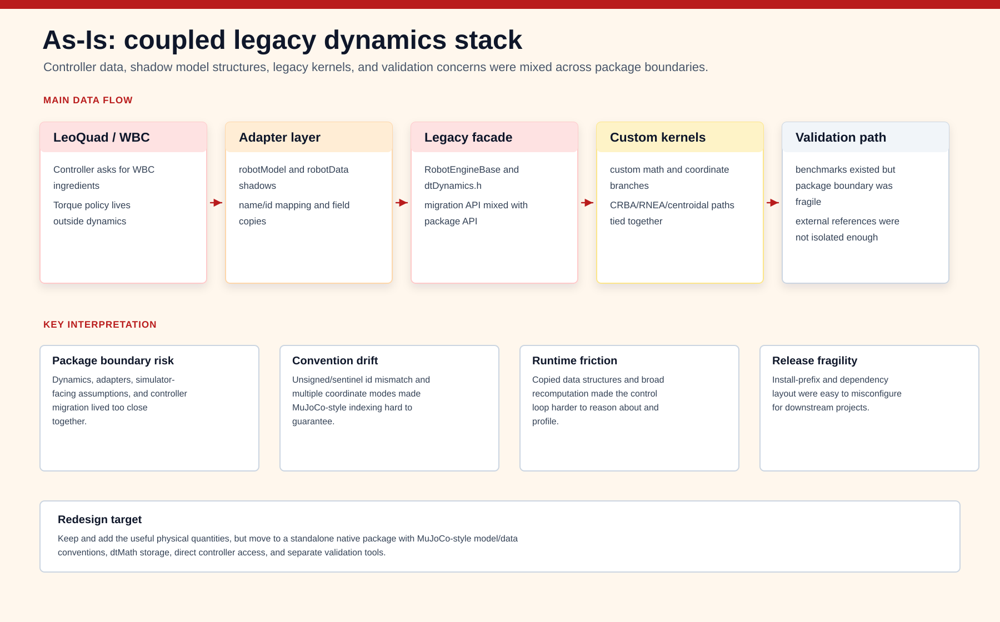

# dtDynamics Manual

> Canonical generated manual: the maintained Doxygen/Graphviz manual source now lives under [`docs/manual/`](manual/index.md). Build it with:
>
> ```bash
> tools/validate_docs.sh
> ```
>
> Generated HTML entry point: `build/docs/doxygen/html/index.html`.
>
> The legacy Markdown manual content is preserved below for continuity while detailed chapters are migrated into the generated manual.

---

## Overview

`dtDynamics` is a lightweight rigid-body dynamics ingredient engine for realtime legged-robot control. It computes the kinematic, dynamic, centroidal, and derivative quantities needed by whole-body control, state estimation, and model-based planning. It does not compute the final controller torque command.

The package is designed around general robot-control requirements:

- deterministic memory ownership after initialization
- fixed, explicit coordinate conventions
- `dtMath` as the only math dependency
- MuJoCo-compatible indexing, XML-oriented model semantics, and smooth-dynamics algorithm structure
- controller-ready quantities that are not all exposed by general simulators

## Redesign Overview Figures

The following figures summarize the package-level migration from the legacy integration path to the standalone native `dt::Dynamics` boundary.




## Relationship To MuJoCo And Pinocchio

`dtDynamics` is not a simulator and is not a MuJoCo wrapper. Its baseline algorithms should follow MuJoCo 3.8.0's smooth-dynamics implementation structure, but they are reimplemented with `dtMath` and native `dtDyn*` types. MuJoCo 3.8.0 is used as an external reference for XML semantics, indexing, transforms, and common dynamics terms. It is not included or linked by the `dtDynamics` package.

Pinocchio is used as an external validation reference for rigid-body dynamics and centroidal quantities that MuJoCo does not directly expose. Pinocchio is also not included or linked by the `dtDynamics` package.

Implementation status: this manual describes the native `dtDyn*` API in namespace `dt::Dynamics`; that native API is the active package boundary.

## CMake Package Boundary

Production consumers should link the installed package through the canonical exported target:

```cmake
find_package(dtDynamics CONFIG REQUIRED)
target_link_libraries(my_controller PRIVATE dt::Dynamics)
```

The production `dtDynamics` target is dtMath-only. MuJoCo and Pinocchio are validation dependencies and are linked only by dedicated test or benchmark executables.

If a downstream project also includes a shared ART Framework include directory, make sure the selected `dtDynamics` package include directory is searched before any older `ART_Framework/include/dtDynamics` copy. Mixing a new `libdtDynamics.a` with stale `dtDynModel` headers changes object layout and can corrupt `dtDynModel`/`dtDynData` arrays at runtime. LeoQuad now defaults to the installed package path and handles this by adding `${DTDYNAMICS_INCLUDE_DIR}` before `${ARTF_INSTALL_DIR}/include` in `dtcontrol`, `simRobot`, and `realRobot` targets.

## Model Layers

`dtDynamics` separates model description, compiled model data, and realtime state.

```text
dtDynSpec
  -> editable XML/native specification
  -> dynamic allocation and deallocation
  -> encode/decode

dtDynModel
  -> compiled immutable topology and inertial constants
  -> MuJoCo-compatible indices and addresses
  -> name lookup tables

dtDynData
  -> mutable qpos/qvel and computed quantities
  -> preallocated scratch buffers
  -> no realtime allocation after construction
```

This separation mirrors the practical model/data split used in high-performance rigid-body engines while keeping the actual package independent and dtMath-only.

## Coordinate Convention

The redesigned engine supports one generalized velocity convention:

```text
qpos = [base position_G, base quaternion_GB, joint position]
qvel = [base linear velocity_G, base angular velocity_B, joint velocity]
```

The redesigned API does not expose a coordinate-type selector or a `DTDYN_COORDINATE_TYPE` constant. No other coordinate type is part of the new public API.

Every exposed quantity uses this basis:

- mass matrix `Mmat`
- Coriolis/centrifugal matrix `Cmat`
- gravity vector `gravityTorq`
- body and site Jacobians
- `Jdot`, `Jdot*qdot`
- CoM Jacobian and derivative
- centroidal momentum matrix and derivative

## Kinematic Tree

The body tree follows MuJoCo-compatible semantics:

- body index `0` is the global/world body
- a body without a joint is fixed to its parent
- free, ball, slide, and hinge joints use MuJoCo-compatible type values
- `qpos` and `qvel` addresses follow MuJoCo-compatible sizes
- fixed bodies preserve names, frames, inertials, sites, and children

Fixed bodies may be optimized internally, but public lookup and task/site indexing must remain stable.

## World Body And Fixed Body Dynamics

Body index `0` is the global/world body. It is an inertial reference frame and a topology root. It is not a physical rigid body in the CCRBA recursion.

The dynamics passes treat body `0` specially:

- world-body scratch buffers are initialized to zero.
- physical body loops start at body index `1`.
- backward composite inertia accumulation stops before body index `0`.
- ancestor traversal stops when the current body is `0`.
- no joint, DOF, qpos address, qvel address, mass, or spatial inertia is assigned to the world body.

Fixed bodies are different from the world body. A fixed body is physical: it can have mass, inertia, names, sites, and children. It has no joint and no generalized coordinates. Match MuJoCo by representing this as no joint, not as a fixed joint type: `body_jntnum = 0`, `body_jntadr = -1`, `body_dofnum = 0`, and `body_dofadr = -1`. Its inertia contributes to its parent/root composite inertia, and its frames can be used for task Jacobians, but it does not create Jacobian, mass-matrix, CMM, or bias columns.

For multi-root models, centroidal quantities are first computed per physical root body. A single-root floating-base robot can read the standard 6-row centroidal matrix directly from `dtDynData`, while a multi-root aggregate should be requested explicitly.

## Closed-Chain And Parallel Mechanisms

The core model is a tree. Serial manipulators, branched fixed-base manipulators, and floating-base quadrupeds fit this model directly. Parallel robots and four-bar linkages do not, because their generalized coordinates are constrained by loop closure.

The MuJoCo-compatible way to represent these mechanisms is tree plus equality constraints:

- cut the loop in the body tree.
- add equality constraints to close it.
- compute normal tree dynamics ingredients.
- compute constraint residuals and constraint Jacobians.
- let the controller or constrained solver enforce the loop.

For closed-chain control, `dtDynamics` should expose:

- `phi(q)`
- `Jc`
- `Jc*qvel`
- `JcDot*qvel`
- KKT matrix ingredients using `M` and `Jc`

It should still not compute final torque. Until the equality layer is implemented, `dtDynSpec` should reject closed-chain/equality XML with an explicit diagnostic instead of loading an incorrect tree-only model.

## Computed Quantities

`dtDynamics` computes ingredients for control:

- body and site pose
- body and site velocity
- linear and angular Jacobians
- Jacobian time variation
- `Jdot*qdot`
- subtree CoM
- total CoM position and velocity
- mass matrix
- controller-compatible Coriolis/centrifugal matrix convention
- Coriolis/centrifugal vector
- gravity vector
- nonlinear vector
- centroidal momentum matrix
- centroidal momentum matrix time derivative
- centroidal momentum
- inertia matrix derivative when needed

The controller consumes these values and computes the final torque.

## Core Algorithm

The main baseline kernel is a native `dtMath` reimplementation of the relevant MuJoCo 3.8.0 smooth-dynamics stages. The algorithm performs:

1. forward body kinematic propagation equivalent to `mj_kinematics`
2. inertial-frame and subtree-CoM mapping equivalent to `mj_comPos`
3. mass matrix construction equivalent to MuJoCo 3.8.0 `mj_makeM`, with CRBA equivalent to `mj_crb` as its first stage
4. optional sparse mass-matrix factorization equivalent to `mj_factorM` if needed by WBC solves
5. CoM-frame velocity and motion-subspace derivative propagation equivalent to `mj_comVel`
6. recursive Newton-Euler bias-force propagation equivalent in purpose to MuJoCo `mj_rne` for `gravityTorq`, `coriolisTorq`, and `nonlinTorq`
7. body/site Jacobian construction equivalent to `mj_jac`, `mj_jacBody`, and `mj_jacSite`
8. Jacobian time-variation construction equivalent to `mj_jacDot`

The dtDynamics-specific layer is the Control-oriented Composite Rigid Body Algorithm, or CCRBA. CCRBA adds quantities MuJoCo does not expose directly in the required control form: controller-compatible `Cmat`, CMM, CMMdot, `comJmatDot`, centroidal momentum derivative ingredients, `MmatDot`, and floating-base/task exports. `ComputeDynamicsRNEA` runs the lighter RNEA path for controllers that need only the MuJoCo-step1-like base ingredients: `Mmat`, `gravityTorq`, `nonlinTorq`, and `coriolisTorq`; its optional `dtDynRneaTermFlags` currently expose only `DTDYN_RNEA_TERM_COM_POS`. `ComputeDynamicsCCRBA` computes the same base ingredients plus `Cmat`, with gravity, Coriolis, and nonlinear torque outputs computed from the CCRBA pass instead of calling RNEA. In the public CCRBA path, `coriolisTorq` is accumulated while `Cmat` is filled, avoiding a second dense `Cmat*qvel` pass. Additional CCRBA outputs are selected with `dtDynCcrbaTermFlags`, such as `DTDYN_CCRBA_TERM_CMAMAT`, `DTDYN_CCRBA_TERM_CMAMAT_DOT`, `DTDYN_CCRBA_TERM_COM_JMAT`, `DTDYN_CCRBA_TERM_COM_JMAT_DOT`, `DTDYN_CCRBA_TERM_CENT_MOM`, `DTDYN_CCRBA_TERM_COM_VEL`, and `DTDYN_CCRBA_TERM_MMAT_DOT`. There is no generic public `ComputeDynamics` alias; callers must choose `ComputeDynamicsRNEA` or `ComputeDynamicsCCRBA` and pass the optional-term mask they need.

The implementation must keep body-indexed and DOF-indexed workspaces separate. Body-indexed arrays include world body `0`; DOF-indexed arrays are sized by `nv` and never include the world body. This distinction is part of the numerical contract because centroidal and CCRBA terms are sensitive to an accidental world-body column.

## Validation

Validation has two external references plus runtime integration checks:

- MuJoCo 3.8.0: validates XML, indexing, transforms, `mj_makeM` mass matrix output, Jacobians, `Jdot`, and common dynamics terms
- Pinocchio: validates CRBA, centroidal mapping, centroidal time variation, Jacobian time variation, and derivative terms

Frame convention and spatial-vector ordering must be transformed explicitly before comparing values.

Validation fixtures should include the world body, fixed sensor/task bodies, and at least one multi-root model if multi-root output is enabled. The world body should never contribute mass, inertia, or DOF columns; fixed bodies should contribute mass and frames without adding DOFs.

External validation libraries are local to the `dtDynamics` package. They must not be installed into `~/.local/ART_Framework`, because that prefix is shared by ART packages and other projects. In a standalone package checkout, the default private validation cache is:

```bash
.validation_deps/
```

The pinned validation versions are MuJoCo `3.8.0` and Pinocchio `3.9.0`. To populate the private cache, run:

```bash
# Run from the standalone dtDynamics package root.
tools/install_validation_deps.sh --all
```

The helper installs MuJoCo under `.validation_deps/mujoco-3.8.0` and Pinocchio under `.validation_deps/pinocchio-3.9.0`. CMake uses these paths by default for validation executables only. Override paths with `DTDYNAMICS_MUJOCO_ROOT`, `DTDYNAMICS_PINOCCHIO_ROOT`, or `DTDYNAMICS_VALIDATION_DEPS_DIR` when needed. LeoQuad's external package validator uses the external package cache by default; set `DTDYNAMICS_VALIDATION_DEPS_DIR` explicitly only when intentionally validating against another private cache.

Pinocchio is installed through a private conda-style prefix. If `micromamba`, `mamba`, or `conda` is not available on the system, the helper bootstraps a private `micromamba` binary under `.validation_deps/micromamba` and uses it only for the validation cache.

The core topology fixtures are:

- single fixed-base manipulator for serial-chain fixed-base behavior.
- dual fixed-base manipulator for branched fixed-base behavior and cross-branch mass coupling.
- fixed-base multi-robot model for independent world-root bodies, root masses, root-index mapping, and actuator metadata across separate model parts.
- floating-base multi-robot model for multiple free-joint roots and per-root centroidal/CoM output validation.
- floating-base quadruped for free-joint, centroidal, and WBC-facing behavior.
- minimal world/fixed-body fixture for early regression coverage of body index `0` and no-joint fixed bodies.
- four-bar/closed-chain fixture for equality-constraint diagnostics first, then loop-constraint ingredients after equality support is implemented.

LeoQuad runtime validation is also required after native package or controller-integration changes. The minimum runtime gate is:

```bash
cmake --build build --target simRobot
tools/validate_simrobot_trot.sh --smoke
tools/validate_simrobot_trot.sh --headless-trot
tools/validate_simrobot_trot.sh --trot
```

The `--smoke` mode catches startup regressions such as unallocated dtMath dynamic vectors. The `--headless-trot` mode runs `simRobot --headless-validate-trot`, bypasses GLFW, steps MuJoCo directly, sends the LeoQuad command sequence `i`, waits three seconds, then sends `f` followed by `i`, and checks that the controller reaches `CTRL_GAIT + GAIT_TROT` with finite state and sane base height. The `--trot` mode exercises the same transition through the visual simulator. Passing the scripted headless run is the automated CI-style gate; final acceptance should still include visual confirmation when simulator rendering or gait quality changed.

For opt-in runtime timing of the migrated dynamics path, run:

```bash
SIMROBOT_PROFILE_DYNAMICS=1 tools/validate_simrobot_trot.sh --headless-trot
```

This prints `Robot::UpdateDynamics` sample count, mean, min, max, and last runtime in microseconds. The profiling flag is off by default so normal simulator/control runs do not pay the clock-measurement cost.
When enabled, the output also splits the mean and last sample into `input`, `native`, and `export` sections. `input` covers qpos/qvel staging and gravity setup, `native` covers the reduced CCRBA plus indexed body/site Jacobians, and `export` covers copying `dtDynData` results into the existing LeoQuad controller-facing fields. A second native split reports reduced CCRBA and indexed Jacobian timing separately.

## Benchmarking

Benchmarks should report:

- update time in microseconds
- maximum and mean errors for each quantity
- dynamic allocation count in the realtime path
- scaling with body count, fixed-body count, branch count, and task/site count

Benchmark states should include nominal stance, asymmetric stance, nonzero base velocity, nonzero joint velocity, and XML models with fixed sensor/task bodies.

The current benchmark targets are:

- `benchmark_dtDynamics`: native `ComputeDynamicsCCRBA(..., DTDYN_CCRBA_TERM_ALL)` timing, internal consistency checks, and setup/off-loop resource rows for `CompileSpec(spec)` and fresh `dtDynData::Resize(model)`.
- `benchmark_dtDynamicsStages`: native per-stage timing for forward kinematics, mass matrix, RNEA, CCRBA and its internal term substages, full Jacobians, indexed task Jacobians, gravity, and explicit RNEA/CCRBA dynamics entry points.
- `benchmark_dtDynamicsReferences`: MuJoCo 3.8.0 and Pinocchio 3.9.0 reference-path timing plus native-vs-reference max/RMS error rows using the private validation cache.

Build and run them with:

```bash
# Run from the standalone dtDynamics package root.
cmake --preset validation
cmake --build --preset validation -- -j2
ctest --preset validation
build/validation/bin/benchmark_dtDynamics
build/validation/bin/benchmark_dtDynamicsStages
build/validation/bin/benchmark_dtDynamicsReferences
```

Reference benchmarks link MuJoCo and Pinocchio only in the benchmark executable. They do not change the production `dtDynamics` package boundary.

Before installing dtDynamics for downstream projects, run the release-readiness audit:

```bash
tools/audit_release_readiness.sh
```

The audit checks package artifacts and release invariants before running the package validator. It verifies that production `include/` and `src/` files have no MuJoCo or Pinocchio API dependency, no legacy facade/API names, no production `std::vector` use in native `dtDyn*` files, and that the `release` preset keeps tests, benchmarks, and reference targets off. It then runs `tools/validate_package.sh` unless `--skip-package-validation` is passed.

After the audit passes and the source tree is committed, create a source
handoff archive:

```bash
tools/package_release.sh --output-dir dist
```

The packaging helper refuses a dirty working tree, runs
`tools/audit_release_readiness.sh` by default, archives git `HEAD`, and writes a
matching `.sha256` checksum. The archive intentionally contains only committed
source files, not `.validation_deps`, build directories, generated benchmark
CSV/log files, or local install scratch directories.

The package validator scans production include/source files for forbidden MuJoCo or Pinocchio API dependencies, builds native and reference tests, builds benchmark executables, runs `ctest`, and then runs the installed-package export check:

```bash
tools/validate_package.sh
```

For a narrower installed-package target and documentation check:

```bash
tools/validate_install_export.sh
```

The helper installs into a temporary prefix, verifies that the package exports `dt::Dynamics` without a legacy `dtDynamics::` target, checks that the installed production config does not contain MuJoCo or Pinocchio references, checks that package docs are installed, and builds a minimal downstream `find_package(dtDynamics CONFIG REQUIRED)` consumer.

Downstream ART Framework integrations should maintain their own installed-package gate. The gate should run this package's release-readiness audit, install directly into `${ARTF_INSTALL_DIR:-~/.local/ART_Framework}`, configure the consumer with `find_package(dtDynamics CONFIG REQUIRED)`, reject stale isolated-prefix selection, and run the consumer's headless validation sequence. The standalone dtDynamics archive intentionally does not ship repository-specific downstream validation scripts.

LeoQuad consumes the installed standalone dtDynamics package. The default installed prefix is `${ARTF_INSTALL_DIR:-~/.local/ART_Framework}`, and it can be overridden with `DTDYNAMICS_INSTALL_PREFIX`:

```bash
cmake -S . -B build-installed-dtdynamics \
  -DCMAKE_BUILD_TYPE=Release \
  -DDTDYNAMICS_INSTALL_PREFIX=/path/to/ART_Framework/install
cmake --build build-installed-dtdynamics --target dtcontrol simRobot -- -j2
```

The top-level LeoQuad build prepends `${DTDYNAMICS_INSTALL_PREFIX}` to `CMAKE_PREFIX_PATH` and sets `DTDYNAMICS_DTMATH_INCLUDE_DIR` to `${ARTF_INSTALL_DIR}/include` before `find_package(dtDynamics)`, matching the ART Framework dtMath install layout. dtDynamics package development is handled in this standalone package checkout, not through a LeoQuad local build override.

`benchmark_dtDynamicsStages` can optionally load one external MJCF-like XML fixture for project-specific timing without adding that robot model to the standalone package:

```bash
DTDYNAMICS_BENCHMARK_ONLY_EXTERNAL=1 \
DTDYNAMICS_BENCHMARK_XML=/path/to/LeoQuad_QD1.xml \
DTDYNAMICS_BENCHMARK_XML_NAME=leoquad_qd1 \
  build/validation/bin/benchmark_dtDynamicsStages
```

Leave `DTDYNAMICS_BENCHMARK_ONLY_EXTERNAL` unset to keep the built-in package fixtures and append the external fixture to the CSV output.

Benchmarks append a final metadata CSV section beginning with `benchmark_metadata,key,value`. It records the benchmark executable name, CMake build type, compiler, C++ standard, platform, CPU model, hardware concurrency, clock source, clock steadiness, warmup iterations, measured iterations, batch count, and `NDEBUG` status.

Set `DTDYNAMICS_BENCHMARK_BATCHES=N` to run each timing row across repeated batches. When `N > 1`, benchmarks append a `benchmark_batch_summary` CSV section with min/median/max of the per-batch mean, median, and p99 runtimes plus the maximum allocation count observed across batches. Leave the variable unset for the default single-batch output.

The reference benchmark prints timing, optional `benchmark_sample`, numerical-error, optional batch-summary, and metadata sections. The numerical-error section begins with `comparison_reference,fixture,state,quantity,count,max_error,max_relative_error,rms_error,abs_tolerance,rel_tolerance,status,diagnostic`. Comparable rows use the documented absolute and relative tolerances; any `status=fail` row makes the executable exit nonzero after emitting the complete CSV. If a reference model is not semantically comparable for a quantity, the benchmark emits `status=skipped` with a diagnostic instead of reporting misleading errors.

The stage benchmark prints one CSV section with `fixture,state,stage,nq,nv,nbody,nsite,iterations,mean_us,median_us,p99_us,allocation_mean,allocation_max`. Generated documentation tables may omit `allocation_mean` and `allocation_max` when every displayed row is zero; the CSV schema keeps them for regression checking. Use it to separate MuJoCo-overlap RNEA costs, dtDynamics-only CCRBA matrix costs, local CCRBA bias-force substages, and explicit Jacobian costs before drawing conclusions about performance. `ComputeDynamicsRNEA` computes the base mass and bias-force ingredients. `ComputeDynamicsCCRBA` computes the base mass, bias-force, and `Cmat` ingredients; optional flags add heavier centroidal outputs only when requested. The stage `compute_dynamics_ccrba_wbc_terms` times the common WBC mask `COM_POS | CMAMAT | CENT_MOM`; `leoquad_wbc_update` times that same reduced CCRBA call followed by indexed body/site `ComputeJacobians`. Neither dynamics call computes body/site Jacobians by itself; call `ComputeJacobians` separately for the full model or with body/site ID arrays for indexed task Jacobians. Plain one-off `ComputeBodyJacobian`, `ComputeSiteJacobian`, and `ComputePointJacobian` calls require current forward kinematics only. Jacobian-derivative, `Jdot*qvel`, combined derivative-term, and bulk/indexed Jacobian writers require a current RNEA or CCRBA pass because they consume dynamics-prepared spatial work arrays. LeoQuad uses the indexed body/site overload rather than `ComputeSiteJacobians`, because the controller still consumes the root/base body Jacobian together with task-site Jacobians. When a controller needs `J`, `Jdot`, and `Jdot*qvel` for a single point/body/site, use `ComputePointJacobianTerms`, `ComputeBodyJacobianTerms`, or `ComputeSiteJacobianTerms` so the shared column terms are computed once.

Use Release builds for benchmark reporting. With single-config Unix Makefiles, an empty `CMAKE_BUILD_TYPE` compiles native `dtDynamics` without optimization, while MuJoCo and Pinocchio are optimized external libraries.

## XML And Native Spec Examples

The XML reader accepts a small MJCF-like subset. The root tag remains `<mujoco>` for file compatibility, but this is syntax only; it does not link the MuJoCo library.

Minimal fixed-base arm:

```xml
<mujoco model="single_arm">
  <worldbody>
    <body name="base" pos="0 0 0">
      <body name="link" pos="1 0 0">
        <inertial pos="0.5 0 0" mass="2.5" diaginertia="0.1 0.2 0.3"/>
        <joint name="hinge_z" type="hinge" axis="0 0 1" armature="0.05"/>
        <site name="tool" pos="1 0 0"/>
      </body>
    </body>
  </worldbody>
  <actuator>
    <motor name="hinge_motor" joint="hinge_z" gear="80"/>
  </actuator>
</mujoco>
```

Floating-base root with a no-joint fixed sensor body:

```xml
<mujoco model="floating_sensor_body">
  <worldbody>
    <body name="base" pos="0 0 0">
      <freejoint name="floating_base"/>
      <body name="fixed_sensor_mount" pos="0.1 0 0">
        <site name="imu_site" pos="0 0 0"/>
      </body>
    </body>
  </worldbody>
</mujoco>
```

The same model can be built programmatically through `dtDynSpec`:

```cpp
#include <dtDynamics/dtDynCompile.h>
#include <dtDynamics/dtDynDynamics.h>
#include <dtDynamics/dtDynKinematics.h>
#include <dtDynamics/dtDynSpec.h>

using namespace dt::Dynamics;

dtDynSpec spec;
const dtDynIndex base = spec.AddBody("base", 0);
spec.AddJoint(base, "floating_base", dtDynJointType::Free);

const dtDynIndex link = spec.AddBody("link", base);
spec.Bodies()[link].pos(0) = 0.35;
spec.Bodies()[link].inertial.mass = 1.0;
spec.Bodies()[link].inertial.inertia(0) = 0.02;
spec.Bodies()[link].inertial.inertia(1) = 0.02;
spec.Bodies()[link].inertial.inertia(2) = 0.01;

const dtDynIndex hip = spec.AddJoint(link, "hip_pitch", dtDynJointType::Hinge);
spec.Joints()[hip].axis(1) = 1.0;
const dtDynIndex foot = spec.AddSite(link, "foot");
spec.Sites()[foot].pos(2) = -0.25;

const dtDynModel model = CompileSpec(spec);
dtDynData data;
data.Resize(model);
```

Set state, run kinematics, dynamics, and task Jacobian terms:

```cpp
data.qpos(0) = 0.0;
data.qpos(1) = 0.0;
data.qpos(2) = 0.5;
data.qpos(3) = 1.0;  // free-joint quaternion w
data.qpos(4) = 0.0;  // x
data.qpos(5) = 0.0;  // y
data.qpos(6) = 0.0;  // z
data.qpos(7) = 0.2;  // first hinge after the free joint

data.qvel.SetZero();
data.qvel(0) = 0.1;  // base linear velocity in world frame
data.qvel(4) = 0.2;  // base angular velocity in body frame, y row
data.qvel(6) = 0.3;  // hinge velocity

dt::Math::Vector3<dtDynReal> gravity;
gravity(0) = 0.0;
gravity(1) = 0.0;
gravity(2) = -9.81;

ForwardKinematics(model, data);

constexpr dtDynCcrbaTermFlags wbcTerms =
    DTDYN_CCRBA_TERM_COM_POS |
    DTDYN_CCRBA_TERM_CMAMAT |
    DTDYN_CCRBA_TERM_CENT_MOM;
ComputeDynamicsCCRBA(model, data, gravity, wbcTerms);

dtDynDenseMatrix jacp;
dtDynDenseMatrix jacr;
dtDynDenseMatrix jacpDot;
dtDynDenseMatrix jacrDot;
dt::Math::Vector3<dtDynReal> linearJdotQvel;
dt::Math::Vector3<dtDynReal> angularJdotQvel;

ComputeSiteJacobianTerms(model,
                         data,
                         model.SiteId("foot"),
                         &jacp,
                         &jacr,
                         &jacpDot,
                         &jacrDot,
                         &linearJdotQvel,
                         &angularJdotQvel);
```

For model-wide cached Jacobians, use `ComputeJacobians(model, data)` after the dynamics call. For realtime controllers, prefer the indexed overload:

```cpp
dtDynArray<dtDynIndex> bodyIds;
dtDynArray<dtDynIndex> siteIds;
bodyIds.push_back(model.root_bodyid[0]);
siteIds.push_back(model.SiteId("foot"));

ComputeJacobians(model, data, bodyIds, siteIds);
```

## Output Quantity Reference

Let `nr = max(model.nroot, 1)` for storage sizing. Centroidal and CoM outputs are stacked by actual model root for multi-root models; when `model.nroot == 0`, the fallback block is reserved storage and is not an implied populated aggregate result. In each 6-row centroidal block, rows `0..2` are linear rows and rows `3..5` are angular rows. `qvel` columns always use the MuJoCo-compatible velocity order described earlier.

| Field | Shape | Frame/order | Prerequisite call | Controller use |
|---|---:|---|---|---|
| `qpos` | `nq` | base position in world, free quaternion `w x y z`, then joints | user writes before computation | generalized position input |
| `qvel` | `nv` | base linear velocity in world, base angular velocity in body, then joints | user writes before computation | generalized velocity input |
| `xpos` | `nbody x 3` | body origin position in world | `ForwardKinematics` or dynamics call | body pose/state export |
| `xmat` | `nbody x 3 x 3` | body orientation in world | `ForwardKinematics` or dynamics call | body frame transforms |
| `xipos` | `nbody x 3` | body inertial-frame CoM position in world | `ForwardKinematics` or dynamics call | CoM and inertia exports |
| `ximat` | `nbody x 3 x 3` | inertial frame orientation in world | `ForwardKinematics` or dynamics call | inertia-frame transforms |
| `subtree_com` | `nbody x 3` | subtree CoM position in world | every `ComputeDynamicsRNEA` or `ComputeDynamicsCCRBA` pass | subtree/root CoM checks |
| `site_xpos` | `nsite x 3` | site position in world | `ForwardKinematics` or dynamics call | task pose export |
| `site_xmat` | `nsite x 3 x 3` | site orientation in world | `ForwardKinematics` or dynamics call | task orientation export |
| `body_jacp`, `site_jacp` | each `3 x nv` | linear velocity rows in world | `ComputeBodyJacobians`, `ComputeSiteJacobians`, or `ComputeJacobians` | task linear acceleration constraints |
| `body_jacr`, `site_jacr` | each `3 x nv` | angular velocity rows | same Jacobian call | task angular acceleration constraints |
| `body_jacp_dot`, `site_jacp_dot` | each `3 x nv` | time derivative of linear Jacobian | same Jacobian call or `Compute*JacobianTerms` | `Jdot*qvel` and feedforward acceleration |
| `body_jacr_dot`, `site_jacr_dot` | each `3 x nv` | time derivative of angular Jacobian | same Jacobian call or `Compute*JacobianTerms` | angular `Jdot*qvel` |
| `Mmat` | `nv x nv` | generalized velocity order | `ComputeDynamicsRNEA` or `ComputeDynamicsCCRBA` | WBC inertia matrix |
| `MmatDot` | `nv x nv` | generalized velocity order | `ComputeDynamicsCCRBA(..., MMAT_DOT)` | derivative-aware controllers and diagnostics |
| `Cmat` | `nv x nv` | controller convention where `coriolisTorq = Cmat * qvel` | `ComputeDynamicsCCRBA` | controllers that need an explicit Coriolis matrix |
| `gravityTorq` | `nv` | generalized force order | `ComputeDynamicsRNEA` or `ComputeDynamicsCCRBA` | gravity compensation ingredient |
| `coriolisTorq` | `nv` | generalized force order | `ComputeDynamicsRNEA` or `ComputeDynamicsCCRBA` | bias-force split and diagnostics |
| `nonlinTorq` | `nv` | `gravityTorq + coriolisTorq` | `ComputeDynamicsRNEA` or `ComputeDynamicsCCRBA` | standard nonlinear/bias torque vector |
| `comJmat` | `3*nr x nv` | per-root CoM linear Jacobian in world | `ComputeDynamicsCCRBA(..., COM_JMAT)` | CoM task constraints |
| `comJmatDot` | `3*nr x nv` | per-root CoM Jacobian derivative in world | `ComputeDynamicsCCRBA(..., COM_JMAT_DOT)` | CoM `Jdot*qvel` |
| `cmAmat` | `6*nr x nv` | per-root centroidal momentum matrix, linear then angular | `ComputeDynamicsCCRBA(..., CMAMAT)` | centroidal momentum control |
| `cmAmatDot` | `6*nr x nv` | time derivative of `cmAmat` | `ComputeDynamicsCCRBA(..., CMAMAT_DOT)` | derivative-aware momentum control |
| `centMom` | `6*nr` | per-root centroidal momentum, linear then angular | `ComputeDynamicsCCRBA(..., CENT_MOM)` | momentum feedback |
| `comPos` | `3*nr` | per-root CoM position in world | `ComputeDynamicsRNEA(..., COM_POS)` or `ComputeDynamicsCCRBA(..., COM_POS)` | CoM tracking |
| `comVel` | `3*nr` | per-root CoM velocity in world | `ComputeDynamicsCCRBA(..., COM_VEL)` | CoM velocity feedback |

Scratch arrays such as `cdof`, `cdof_dot`, `cvel`, `cinert`, `crb`, `BmatComp`, `f1`, `f2`, and `f3` are exposed in `dtDynData` for validation and advanced diagnostics. Controllers should treat them as implementation details unless they are intentionally validating the spatial algorithm.

## Controller Integration

Controllers should consume `dtDynModel` and `dtDynData` directly. For LeoQuad migration, the control stack should stop copying dynamics outputs into a separate shadow data structure and should read these fields directly from `dtDynData`:

- `Mmat`
- `Cmat`
- `gravityTorq`
- `nonlinTorq`
- `linTaskJmat`
- `angTaskJmat`
- `linJmatDotqVel`
- `angJmatDotqVel`
- `comJmat`
- `comJmatDot`
- `cmAmat`
- `cmAmatDot`
- `centMom`

Legacy LeoQuad body numbering should be migrated to MuJoCo-compatible `dtDynModel` IDs. Controllers can cache named body/site/joint IDs during initialization as controller configuration.

The expected LeoQuad realtime sequence is:

```cpp
constexpr dtDynCcrbaTermFlags dynamicsTerms =
    DTDYN_CCRBA_TERM_COM_POS |
    DTDYN_CCRBA_TERM_CMAMAT |
    DTDYN_CCRBA_TERM_CENT_MOM;

ComputeDynamicsCCRBA(model, data, gravity, dynamicsTerms);
ComputeJacobians(model, data, cachedBodyIds, cachedSiteIds);
```

`cachedBodyIds` should include the root/base body when the controller needs a base Jacobian. `cachedSiteIds` should include only the task sites required by the current control stack. This keeps Jacobian computation outside the dynamics pass while avoiding the incorrect site-only shortcut for controllers that depend on base-body quantities.

For one-off task points, request the exact Jacobian terms needed in one call:

```cpp
dtDynDenseMatrix footJacp;
dtDynDenseMatrix footJacr;
dtDynDenseMatrix footJacpDot;
dtDynDenseMatrix footJacrDot;
dt::Math::Vector3<dtDynReal> footLinJdotQvel;
dt::Math::Vector3<dtDynReal> footAngJdotQvel;

ComputeSiteJacobianTerms(model,
                         data,
                         footSiteId,
                         &footJacp,
                         &footJacr,
                         &footJacpDot,
                         &footJacrDot,
                         &footLinJdotQvel,
                         &footAngJdotQvel);
```

Pass `nullptr` for outputs that are not needed. This API keeps task-specific `J`, `Jdot`, and `Jdot*qvel` requests separate from the model-wide cached Jacobian arrays in `dtDynData`.

## Scope Limits

The first redesign does not include:

- contact solving
- forward simulation integrators
- final torque command generation
- dual-quaternion generalized coordinates
- multiple coordinate-type modes
- full MJCF feature parity
- closed-chain dynamics before the equality-constraint layer is implemented

Current native XML support covers a small MJCF-like subset for bodies, inertials, joints, sites, and motor actuators. Unsupported loop-closure features such as `<equality>` and tendon elements fail with explicit diagnostics until the equality-constraint layer is implemented.
