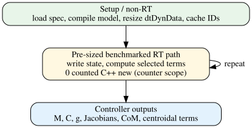

# 5. Realtime resource model

Author: Joonhee Jo



- Realtime 통합 원칙: setup allocation과 control-loop compute 분리

## 5-1. Setup/Realtime 경계 원칙

- Realtime 통합 원칙: setup allocation과 control-loop compute 분리
- setup 수행 위치: loop 밖 (XML I/O, validation, compile, resize, name lookup)
- realtime 수행 항목: state staging, 필요한 최소 `ComputeDynamics*` 호출, active task Jacobian, controller로 결과 전달

> **주의 — setup-time vs realtime 경계**
>
> loop 배제 대상: XML I/O, validation, compile, resize, name lookup, model hot-swap.

- 단계별 checklist는 `docs/manual.md` 5장 "Realtime 적용 checklist" 참고

- benchmark의 `dtDynData_resource` row 측정 대상: fresh construction + `Resize(model)` 비용
- 처리 원칙: 이 setup 비용은 per-tick compute와 미합산

## 5-2. Allocation evidence

- raw benchmark compute row 기록 방식: executable의 C++ `operator new`/`operator new[]` counter로 다음 기록
  - `allocation_mean`, `allocation_max`
  - `allocation_bytes_mean`, `allocation_bytes_max`

- preallocated `dtDynData`와 pre-sized caller output을 사용한 문서화된 compute scope의 목표값

```math
\mathrm{alloc}_{count}^{tick}=0, \qquad
\mathrm{alloc}_{bytes}^{tick}=0.
```

- 성격: arbitrary API에 대한 universal guarantee 아님
- 별도 profiler·deployment test 필요 영역: dtMath container가 사용하는 `malloc`/`calloc`/`realloc`, external library, allocator 내부 동작, OS/runtime, logging, one-time initialization

| Phase | 예 | C++ heap policy |
|---|---|---|
| setup | `ValidateSpec`, `CompileSpecChecked`, `Resize`, lookup | 허용 |
| loop | preallocated `ComputeDynamics*`, selected Jacobian, 조건을 만족한 `UpdateSpec` | 계측 scope에서 0을 목표 |

## 5-3. Fixed-layout physical parameter update

- `UpdateSpec(const dtDynSpec&, dtDynModel&)`는 storage·topology·name map을 바꾸지 않는 physical parameter 갱신용 API다.
- 허용 범위: body pose/inertial pose/mass/inertia, joint anchor/axis/limit/armature, site pose, actuator gear와 이 값에서 파생되는 matrix·`dof_armature`·subtree/root mass cache.
- 허용하지 않는 범위: body/joint/site/actuator 수, parent/owner 관계, joint type, qpos/dof address, root mapping, actuator-to-joint mapping, name 변경. 이 경우 `UpdateSpec()`은 model write 없이 `false`를 반환한다.
- RT 진입 전 조건: editable spec 생성·`Edit*`·외부 입력 validation은 loop 밖에서 끝내고, physical input validity와 fixed layout은 caller가 보장한다. `CompileSpecChecked()`와 `ValidateSpec()`/`ValidateModel()`은 update path에 넣지 않는다.
- 적용 조건: model reader가 없는 control-safe boundary에서만 호출한다. 같은 `dtDynModel`을 읽는 dynamics/kinematics thread와 동시 실행하면 data race가 된다.
- 성공 뒤 기존 `dtDynData` kinematics/dynamics output은 stale이다. 다음 소비 전 `ForwardKinematics` 또는 필요한 `ComputeDynamics*()`를 다시 실행한다.
- allocation-free regression은 successful update 동안 C++ `operator new`/`operator new[]` count가 증가하지 않음을 확인한다. 다만 preflight와 cache refresh는 model 전체를 순회하므로 hard-realtime deadline 보장은 별도다. target CPU에서 worst-case time과 scheduler/allocator 영향을 계측한다.

## 5-4. 여러 evaluation instance

- 공유 가능: immutable `dtDynModel`
- 개별 보유 원칙: mutable `dtDynData`는 estimator copy, MPC rollout, controller thread마다 별도 (동시에 같은 data 미사용)

- robot description 변경 시 절차: setup으로 복귀 → checked compile, resize, ID/address rebuild 완료 후 realtime 재개
- package-level neutral/default initializer: NO-GO

## 5-5. Timing 해석

- median/p95/p99 성격: 통계적 observation
- CPU affinity 고정 후에도 잔존 요인: governor, scheduler, thermal state
- current evidence 미포함 항목: hard-realtime priority, deadline proof, frequency lock
- 관계 아님: setup `Resize` timing과 independently measured stage median은 additive decomposition

## 관련 문서

- 이전 chapter: [최소 end-to-end 예제](example.md)
- 다음 chapter: [검증](validation.md)
- 전체 목차: [전체 목차](index.md)
- 실행 절차(setup/realtime checklist): `docs/manual.md` 5장
