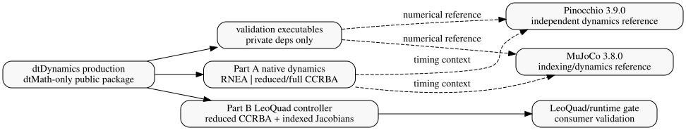

# 6. 검증

Author: Joonhee Jo



> **주의 — production dependency vs validation dependency**
>
> Validation dependency 위치: production package 경계 밖. production public header/export 미포함 항목: MuJoCo·Pinocchio API.

## 6-1. Setup validation

> **주의 — fail-closed validation 동작**
>
> `ValidateSpec()`와 `CompileSpecChecked()` 원칙: 외부 XML과 committed callback edit를 모두 비신뢰 setup input으로 취급.

- setup에서 검사하는 항목: ownership, parent/root topology, duplicate name, joint type/axis, finite physical data, quaternion/rotation, inertia, index/dimension overflow
- 지원 범위 안에서 scan 성격: linear, dynamics hot loop 밖

- XML 오류 보고 방식: `dtDynXmlError`의 typed code, exact source path, zero-based byte offset으로 lexical·structural·semantic failure 보고
- `what()` 성격: human detail (machine interface 아님)

## 6-2. Native validation

- Native test 확인 항목: dimensions, addresses, world/fixed body, multi-root, Jacobian shape, cross-path residual, zero-DoF resize, lookup copy/rebuild, malformed XML negative path
- 예: mass symmetry 확인 방식

```math
\epsilon_M=\lVert M-M^\mathsf{T}\rVert_\infty
```

## 6-3. External numerical reference

- Reference comparison 선행 작업: coordinate, frame, spatial row order 명시적 변환

```math
\epsilon_y=\lVert y_{dtDynamics}-T(y_{ref})\rVert.
```

- MuJoCo 3.8.0 참조 대상: overlapping smooth-dynamics/indexing quantity
- Pinocchio 3.9.0 참조 대상: independent rigid-body quantity
- equivalent contract 없는 row 처리: 통과로 미집계, `skipped` diagnostic으로 기록
- 실패 조건: actual, expected, residual, relative error, RMS, tolerance 중 하나라도 non-finite

## 6-4. Timing independence

- MuJoCo/Pinocchio measured interval 포함 범위: pinned external call set만
- interval 내 금지 사항: native validation, bridge comparison 실행
- 검사 방식: `benchmark_metadata` guard와 zero bridge-counter
- external timing 해석: same-output speed comparison이 아닌 contextual reference-library overhead

## 6-5. Artifact validation

- 채택한 raw run 요구 사항: 72 timing key와 대응하는 seven-batch summary 72개
- promoted runtime CSV의 external row가 만족할 exact Cartesian product:
  - engine: MuJoCo, Pinocchio
  - fixture: 8개
  - state: 3개
  - 총 48개 unique key

- 거부 조건: row count만 맞고 key가 duplicate/missing인 경우
- 검사 항목: median/p95/p99 ordering, finite value, raw summary와 promoted CSV의 exact value agreement
- 실행 명령: `docs/manual.md` 6장 "검증 실행 방법" 참고

## 6-6. Static-analysis gate

- authoritative evidence: GitLab `polyspace-job` job artifact의 canonical `result_list.txt`
- analysis scope: production `dtDynamics` library의 compile database. test, benchmark, MuJoCo/Pinocchio reference target은 이 static-analysis scope에 포함하지 않음
- 결과 범위: dtDynamics 자체 소스(`src/`, `include/dtDynamics/`)로 한정. 시스템 헤더, 설치된 ART Framework prefix, CI가 고정 SHA로 checkout한 dtMath(`.ci/dtmath`)는 `polyspace/polyspace.opts`의 `-do-not-generate-results-for`로 결과에서 제외. 제외 대상은 dtMath 의존성이며 dtDynamics 소스의 non-Green row는 제외하지 않음
- checker profile: `polyspace/checkers.xml`에 고정한 Bug Finder 237개와 MISRA C++:2023 179개 rule. full profile은 `tools/test_polyspace_checker_profile.py`가 검증
- execution: `ci/polyspace.sh`는 cache 결과, 기존 configure options, 기존 report를 제거하고 현재 compile database에서 nonempty configure options를 새로 만든다. 이후 새 canonical `result_list.txt`만 `tools/polyspace_result_gate.py`에 전달한다. parser exit code가 GitLab job exit를 결정하며 Access upload는 이 판정을 바꾸지 않는다.
- canonical schema: TSV header는 `ID`부터 `Col`까지 정해진 16개 column이 같은 순서로 있어야 한다. 축약·순서 변경·추가 column은 거부한다.
- TSV field boundary: 필드 경계는 literal TAB만 사용한다. 큰따옴표(`"`)는 일반 데이터로 취급하며 따옴표 처리나 행 결합에 사용하지 않는다. 따라서 큰따옴표로 감싼 TAB도 추가 field로 거부한다.
- acceptance: 모든 row가 `Color=Green` 및 blank/`Unreviewed` status여야 한다. reviewed `Justified` row도 raw defect가 남은 것이므로 허용하지 않는다.
- 설정 단계 heap deviation(잠정): 동적 메모리 rule 21.6.1/21.6.2/21.6.3은 설정 단계 파일에 한해 deviation으로 인정한다. 설정 단계는 XML I/O, 검증, compile, spec/model container이며 로봇 모델마다 크기가 달라 고정 크기 상한을 두지 않는다. 대상 파일과 rule 조합은 `polyspace/setup_phase_deviation.txt`에 나열하며 `ci/polyspace.sh`가 `--setup-phase-deviation`으로 gate에 전달한다.
- deviation 범위: 목록의 파일·rule 조합만 `deviated`로 따로 집계한다. 같은 rule이 목록 밖 파일(실시간 경로 포함)에서 나오면 `unresolved`이며 job은 실패한다. 21.6.1~21.6.3 외 rule은 목록에 넣을 수 없다. `--setup-phase-deviation`을 주지 않으면 gate는 기존처럼 strict로 동작한다.
- 대체 증거: 실시간 경로(`dtDynDynamics`, `dtDynKinematics`, `dtDynMath`, `dtDynUtils`, `dtDynData`, `dtDynTypes`)의 21.6.x는 0건이어야 한다. `TestRealtimeComputePathPerformsNoHeapAllocation`이 `operator new`와 직접 `malloc`/`calloc`/`realloc` 호출(dtMath dense 저장소, Linux에서 링커 `--wrap`) 계수로 `ForwardKinematics`, RNEA/CCRBA, body/site/point Jacobian 계열 전체와 `UpdateSpec`의 무할당을 확인한다.
- 잠정 효력: 이 deviation은 MISRA 검수 팀 정책이 정해지기 전까지 유지하는 잠정 방침이며 팀 결정 시 목록 또는 gate를 다시 평가한다.
- fail-closed: non-Green, reviewed status, malformed TSV, missing field, `File does not compile`은 모두 job failure

## 6-7. Current package gate

- 문서에 적은 pass snapshot 성격: rerun을 미대체
- 재실행 조건: compiler, dependency, model, benchmark source 변경 시 같은 semantic gate 재실행
- 실행 명령: `docs/manual.md` 6장 "검증 실행 방법" 참고

## 관련 문서

- 이전 chapter: [Realtime resource model](realtime.md)
- 다음 chapter: [Benchmark](benchmarks.md)
- 전체 목차: [전체 목차](index.md)
- 실행 절차(validation gate 명령): `docs/manual.md` 6장
